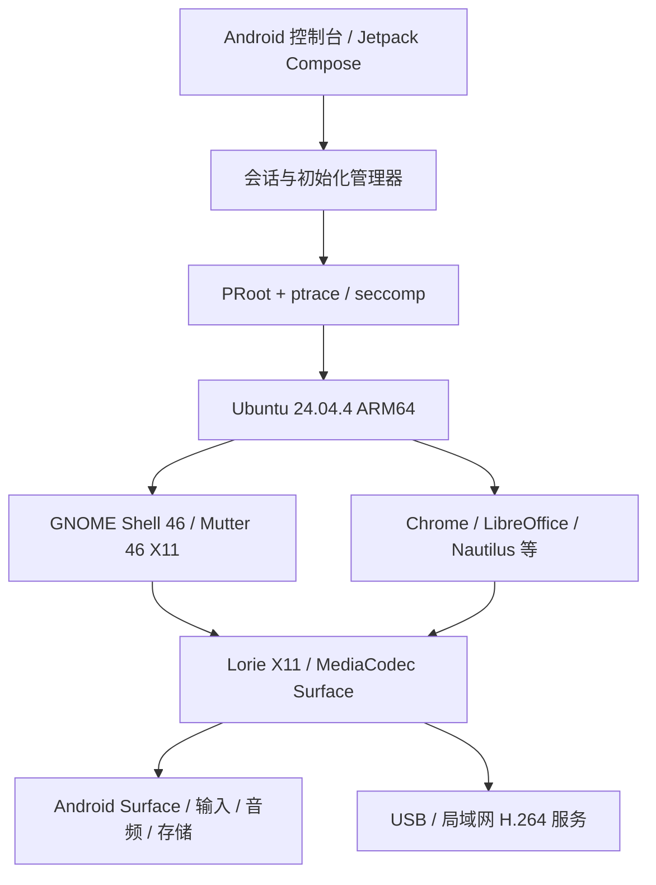
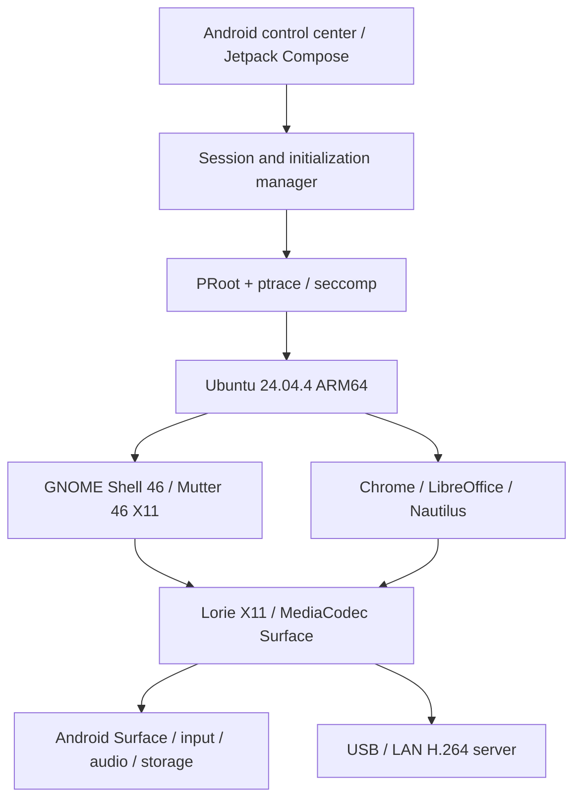

# Architecture / 技术架构

[简体中文](#简体中文) · [English](#english)

## 简体中文

### 总览

LinuxHub 在 Android ARM64 设备本地运行 Ubuntu 24.04.4 ARM64、官方 GNOME Shell 46、Mutter 46 X11、Lorie X11 和 PRoot。Android 负责画面、输入、音频、共享存储、生命周期与远程传输；Ubuntu 负责完整 Linux 用户空间、桌面和应用程序。



### Android 应用层

主要职责：

- Jetpack Compose 首页、运行时状态和初始化配置。
- 权限、GPU 线路、用户名、密码和存储空间检查。
- Android Surface 创建、缩放、分离和销毁。
- 软键盘、触摸、手写笔、鼠标和外接键盘输入。
- PulseAudio FIFO 到 `AudioTrack` 的音频输出。
- `/storage/emulated/0` 共享存储绑定。
- 前台服务、首帧检测、空闲保活和进程看门狗。
- USB / 局域网远程桌面服务与配对。

### 初始化与运行资源

初始化按可恢复任务执行：

1. 校验设备架构、Android 版本、权限和可用空间。
2. 展开 Ubuntu 24.04.4 base rootfs。
3. 释放离线官方 GNOME DEB 集合。
4. 按依赖批次安装 GNOME、Mesa、字体、中文环境和桌面应用。
5. 部署 vendor 应用、`.deb` 安装器、CA 信任库和 GPU 启动器。
6. 建立用户、sudo、locale、时区、主机名和 XDG 目录。
7. 校验软链接、硬链接、SUID / SGID 与合并 `/usr`。
8. 启动 D-Bus、PulseAudio、GNOME session 和 X11 桌面。

APK 覆盖升级通过内容指纹迁移新增或更新的 vendor 应用；运行资源按 APK 内容版本刷新，不要求重新初始化。

### PRoot 与系统调用兼容

- 使用 `ptrace` 拦截系统调用并重写容器路径。
- 使用 `seccomp` 配合 Android 父进程限制。
- `fake_id0` 提供用户空间 fake root 与 UID / GID 映射。
- ashmem 转换为 memfd，满足 Ubuntu 图形和共享内存库。
- 修复 memfd 读 / 写模式判断和 Android 拒绝调用的恢复路径。
- 修复 rootfs 软链接、硬链接、SUID / SGID 与 `/usr` 合并语义。

### 网络钩子

Ubuntu 的 `getifaddrs()` 由 `LD_PRELOAD` 拦截：

```text
Ubuntu glibc client
    │ TIF1 framed protocol over private Unix socket
    ▼
Rust getifaddrs bridge
    │ Android APIs
    ▼
Real IPv4 / IPv6 interfaces
```

该链路修复 IPv6 `sockaddr_in6` 截断、短读、断连和数据粘连；桥接不可用时回退 libc 原始实现。每次终端或桌面启动都会从 APK 刷新 client。

### GNOME 与 X11

- 官方 GNOME Shell 46 和 Mutter 46 运行在 Lorie X11 上。
- 独立 LinuxHub GNOME session mode 与私有 D-Bus。
- `G_RESOURCE_OVERLAYS` 注入启动资源和会话兼容数据。
- DING 扩展负责桌面图标、文件拖放和剪贴板。
- Xserver 修补 Present、VBlank、Damage、GPU 复制完成和缓冲回收。
- 空闲 Surface 每秒提交一帧，避免厂商 Surface 缓冲超时。
- X11 生命周期与会话绑定，停止后清理残留进程。

### GPU 启动链

```text
Desktop launcher / Terminal command / Android launch
                         │
                    doro-gpu-run
              ┌──────────┴──────────┐
              ▼                     ▼
     Qualcomm Zink/Turnip    MediaTek VirGL/virpipe
              └──────────┬──────────┘
                         ▼
                 Application renderer

GNOME Shell / Mutter ───────► llvmpipe compositor
```

GTK4 应用在高通 Zink 路径上使用 Cairo 绘制，避免文件管理器花纹和损坏区域。GPU 启动失败时自动回退 llvmpipe。

### 输入与显示

- 单指移动控制 X11 指针，点击、长按和拖拽映射为鼠标按钮。
- 双指手势映射为滚轮。
- 直接触摸、模拟触摸和触摸板模式可切换。
- 指针捕获支持方向转换和速度设置。
- 手写笔可作为鼠标。
- Android IME、硬件键盘、扫描码和 DeX Meta 键进入统一 X11 输入路径。
- 支持原生、缩放、精确和自定义分辨率，以及最近邻、双线性过滤。

### 音频桥

```text
Ubuntu application
      │
PulseAudio module-pipe-sink
      │ PCM FIFO
      ▼
Android AudioTrack
      │
Phone speaker / headset
```

音频桥独立于 GNOME 会话，失败不会终止桌面。顶部栏同时显示 Android 电池状态。

### USB / 局域网远程桌面

- USB 通过 ADB 端口转发，局域网通过手机地址访问。
- HTTPS、自签名证书和六位配对码。
- X11 画面直接进入 MediaCodec Surface，由 Android 硬件编码 H.264。
- 浏览器通过 WebCodecs 解码。
- 根据延迟和编码队列动态调整码率。
- 队列拥塞时丢弃旧帧、请求关键帧，并使用 `drop-input-frames` 控制输入积压。

### 会话控制

`Rust linuxhub-sessiond` 负责：

- 启动计划和环境检查。
- helper 编排。
- 首帧、Shell 可见性和启动完成诊断。
- 停止、重启和失败日志采集。
- 运行资源版本检查。

它不替换 GNOME Shell、Mutter、GJS、Xserver 或 Linux 应用。

### 安全边界

- PRoot 是用户空间兼容层，不是硬件虚拟化安全沙箱。
- 只运行可信 Linux 软件，谨慎绑定 Android 个人目录。
- 远程桌面只在用户主动开启后提供服务，并需要配对码。
- 自签名 HTTPS 不能替代可信证书；不要在不可信网络公开远程端口。
- 不要公开配对码、日志中的本地地址、用户名或设备路径。

## English

### Overview

LinuxHub runs Ubuntu 24.04.4 ARM64, official GNOME Shell 46, Mutter 46 X11, Lorie X11, and PRoot locally on Android ARM64 devices. Android provides presentation, input, audio, shared storage, lifecycle management, and remote transport. Ubuntu provides the complete Linux user space, desktop, and applications.



### Android application layer

Responsibilities:

- Jetpack Compose home screen, runtime state, and initialization configuration.
- Permission, GPU route, username, password, and free-space checks.
- Android Surface creation, resize, detachment, and destruction.
- Soft keyboard, touch, stylus, mouse, and external keyboard input.
- PulseAudio FIFO to `AudioTrack` output.
- `/storage/emulated/0` shared-storage binding.
- Foreground service, first-frame detection, idle keepalive, and process watchdog.
- USB / LAN remote desktop service and pairing.

### Initialization and runtime assets

Initialization runs as recoverable tasks:

1. Validate architecture, Android version, permissions, and free space.
2. Expand the Ubuntu 24.04.4 base rootfs.
3. Extract the offline official GNOME DEB set.
4. Install GNOME, Mesa, fonts, Chinese support, and desktop applications in dependency order.
5. Deploy vendor applications, the `.deb` installer, CA trust store, and GPU launchers.
6. Configure the user, sudo, locale, timezone, hostname, and XDG directories.
7. Validate symlinks, hardlinks, SUID / SGID, and merged `/usr`.
8. Start D-Bus, PulseAudio, the GNOME session, and the X11 desktop.

Overwrite upgrades use content fingerprints to migrate new or updated vendor applications. Runtime assets are refreshed by APK content version without requiring a new initialization.

### PRoot and syscall compatibility

- Intercept syscalls with `ptrace` and rewrite container paths.
- Apply `seccomp` rules compatible with the Android parent process.
- Provide user-space fake root and UID / GID mapping through `fake_id0`.
- Translate ashmem into memfd for Ubuntu graphics and shared-memory libraries.
- Fix memfd read / write mode detection and recovery from denied Android syscalls.
- Repair rootfs symlink, hardlink, SUID / SGID, and merged `/usr` semantics.

### Network hook

Ubuntu `getifaddrs()` is intercepted through `LD_PRELOAD`:

```text
Ubuntu glibc client
    │ TIF1 framed protocol over private Unix socket
    ▼
Rust getifaddrs bridge
    │ Android APIs
    ▼
Real IPv4 / IPv6 interfaces
```

The bridge handles IPv6 `sockaddr_in6` truncation, short reads, disconnects, and coalesced data. It falls back to libc when unavailable. The client is refreshed from the APK on every terminal and desktop start.

### GNOME and X11

- Official GNOME Shell 46 and Mutter 46 run on Lorie X11.
- A dedicated LinuxHub GNOME session mode uses private D-Bus.
- `G_RESOURCE_OVERLAYS` supplies startup and session compatibility resources.
- DING provides desktop icons, file drag-and-drop, and clipboard integration.
- Xserver patches cover Present, VBlank, Damage, GPU-copy completion, and buffer recycling.
- The idle Surface submits one frame per second to avoid vendor buffer timeouts.
- X11 lifecycle is bound to the session and cleaned up after stop.

### GPU launch path

```text
Desktop launcher / Terminal command / Android launch
                         │
                    doro-gpu-run
              ┌──────────┴──────────┐
              ▼                     ▼
     Qualcomm Zink/Turnip    MediaTek VirGL/virpipe
              └──────────┬──────────┘
                         ▼
                 Application renderer

GNOME Shell / Mutter ───────► llvmpipe compositor
```

GTK4 applications use Cairo on affected Qualcomm Zink paths to avoid damaged regions. A failed GPU path falls back to llvmpipe.

### Input and display

- One-finger movement controls the X11 pointer; tap, long press, and drag map to mouse buttons.
- Two-finger gestures map to scrolling.
- Direct-touch, simulated-touch, and touchpad modes are configurable.
- Pointer capture supports direction transforms and speed settings.
- A stylus can act as a mouse.
- Android IME, hardware keyboard, scancodes, and the DeX Meta key enter one X11 input path.
- Native, scaled, exact, and custom resolutions are supported with nearest-neighbor and bilinear filtering.

### Audio bridge

```text
Ubuntu application
      │
PulseAudio module-pipe-sink
      │ PCM FIFO
      ▼
Android AudioTrack
      │
Phone speaker / headset
```

The audio bridge is isolated from the GNOME session. Android battery status is also exposed to the top bar.

### USB / LAN remote desktop

- USB uses ADB port forwarding; LAN uses the phone address.
- HTTPS, a self-signed certificate, and a six-digit pairing code protect access.
- X11 frames enter a MediaCodec Surface for Android hardware H.264 encoding.
- The browser decodes with WebCodecs.
- Bitrate adapts to latency and encoder queue pressure.
- Congestion drops stale frames, requests keyframes, and uses `drop-input-frames` to control accumulated input.

### Session control

Rust `linuxhub-sessiond` manages:

- Startup planning and environment checks.
- Helper orchestration.
- First-frame, Shell-visibility, and startup-completion diagnostics.
- Stop, restart, and failure-log collection.
- Runtime asset version checks.

It does not replace GNOME Shell, Mutter, GJS, Xserver, or Linux applications.

### Security boundaries

- PRoot is a user-space compatibility layer, not a hardware virtualization sandbox.
- Run trusted Linux software and bind personal Android directories with care.
- Remote desktop runs only after the user starts it and requires a pairing code.
- A self-signed HTTPS certificate is not a trusted public CA certificate; do not expose the remote port on an untrusted network.
- Do not publish pairing codes, local addresses, usernames, or device paths from logs.