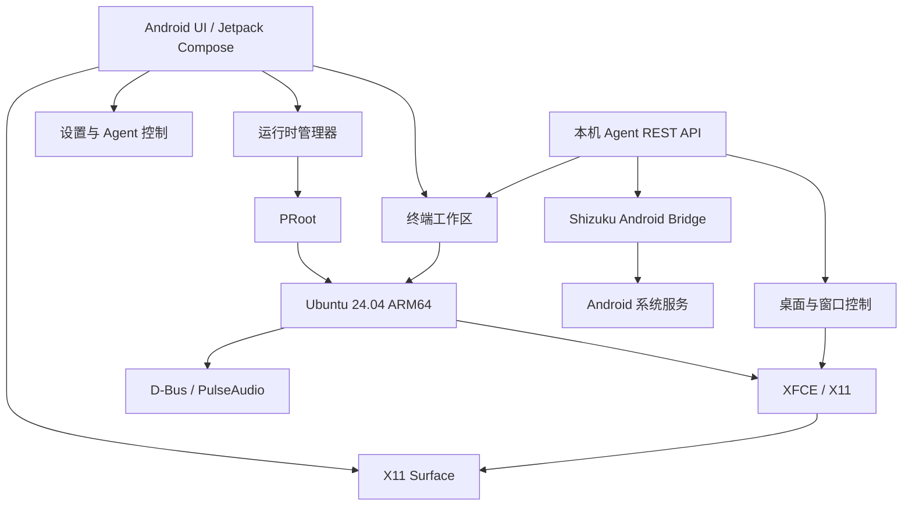
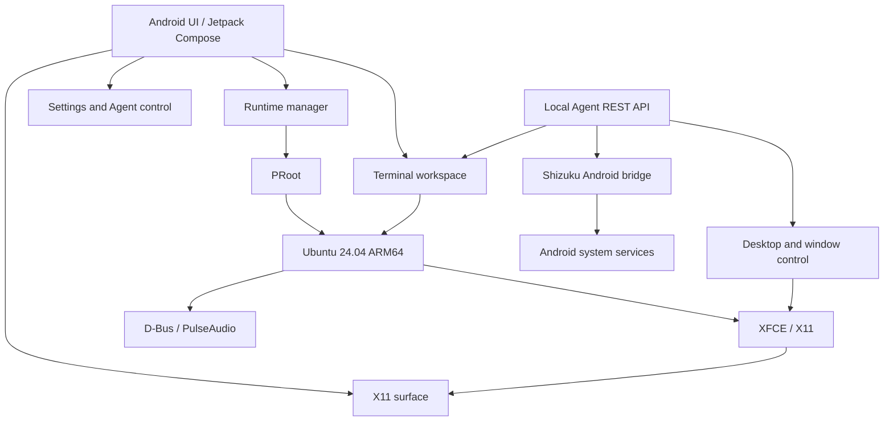

# Architecture / 技术架构

[简体中文](#简体中文) · [English](#english)

## 简体中文

### 总览

LinuxHub 将 Android 原生界面、PRoot Linux 用户空间、XFCE 桌面、X11 显示运行时、Android 权限桥和本机 Agent 连接为一套移动 Linux 工作区。



### Android 应用层

Android 应用层负责用户界面、生命周期、终端呈现、桌面 Surface、运行时状态和本机 Agent 控制。

主要职责：

- Jetpack Compose 页面与状态管理
- 首次部署、任务进度、错误状态和运行环境恢复
- Android Surface 创建、缩放、分离和销毁
- 终端标签、会话和多任务切换
- Android 软键盘、外接键盘和鼠标事件接收
- X11 与 PRoot 生命周期协调
- Agent 服务的启用、停用、Endpoint 与 Token 展示

### Linux 运行层

LinuxHub 使用 PRoot 运行 Ubuntu 24.04 ARM64 用户空间，不修改 Android 系统分区。

运行时负责：

- RootFS 展开、完整性检查和离线资源部署
- Android 目录到 Linux 的受控绑定挂载
- 用户、密码、sudo、语言环境、时区和主机名配置
- X11、XFCE、D-Bus、PulseAudio 与桌面组件启动
- `/sdcard` 共享存储访问
- 进程清理、看门狗与异常状态恢复

### X11 与桌面

LinuxHub 使用内嵌 X11 Runtime，显示链路基于 Termux:X11 / Lorie。X11 Server 与应用生命周期绑定，桌面 Surface 只负责呈现，不重复创建 Linux 会话。

```text
XFCE / X11 applications
          │
       X11 Server
          │
   Android Surface
          │
     LinuxHub UI
```

运行时支持：

- 无头 X11 模式
- 附加显示 Surface
- 桌面尺寸与密度查询
- Surface resize
- 桌面停止与重新启动
- 通过 `desktop.*` 工具查询和控制窗口

### 输入链路

Android 输入事件由 LinuxHub 转换为 Linux 输入语义：

- 单指移动到 X11 指针
- 轻点映射为左键按下与释放
- 长按先发送右键按下，再在抬手时发送释放
- 长按后移动映射为拖拽
- 双指滑动映射为横向或纵向滚轮
- Android IME 文本提交到当前 Linux 焦点
- 外接鼠标与键盘转换为对应 X11 事件

Agent 输入与普通 Android 软键盘使用独立通道。Agent 调用 `desktop.text` 或 `desktop.key` 时，不改变用户软键盘的正常焦点归属。

### 本机 Agent

LinuxHub 在 Android 应用进程边界内提供仅监听回环地址的 Agent 服务。

```text
Agent client
    │  HTTP + Bearer Token
    ▼
127.0.0.1:38473
    │
    ├── terminal.*   → PRoot / Ubuntu
    ├── desktop.*    → X11 / XFCE / windows
    ├── system.*     → runtime state
    └── android.*    → Shizuku bridge
```

接口分为：

- `GET /v1/health`：服务与运行环境状态
- `GET /v1/tools`：工具目录与参数定义
- `POST /v1/tools/call`：结构化工具调用
- `POST /v1/cli/exec`：通过 Agent 执行容器命令

工具选择遵循语义优先原则：

1. 先查询应用与窗口。
2. 等待目标窗口出现。
3. 使用唯一匹配的窗口标识。
4. 通过键盘、文本或相对窗口操作完成任务。
5. 使用截图或状态查询验证结果。
6. 礼貌关闭窗口并确认消失。

### Android 权限桥

LinuxHub 可以通过 Shizuku 获取用户授权的 shell/ADB 身份，不需要 Root，也不需要外部 ADB server。

可桥接的能力包括：

- Android shell 命令
- Android 屏幕截图
- Android 输入事件
- Android 与 Linux 之间的文件传输
- APK 安装与卸载
- 默认浏览器角色查询与切换

Linux 终端、X11、XFCE 和桌面工具不依赖 Shizuku；只有 `android.*` 工具域需要此桥接。

### 中文环境

中文能力覆盖从系统到应用的完整路径：

- `zh_CN.UTF-8` locale
- Noto CJK 字体
- Fcitx5 中文输入与候选组件
- XFCE 组件中文翻译
- 中文应用名称与桌面菜单
- 终端 UTF-8 渲染与组合输入
- Agent UTF-8 文本输入

### 安全边界

- Agent 只监听 `127.0.0.1`
- 工具调用需要 Bearer Token
- Token 不写入健康检查响应和运行日志
- Shizuku 提供高权限 shell 身份，只对可信 Agent 开放
- PRoot 是用户空间环境，不是硬件虚拟化安全边界
- 只应运行可信 Linux 软件，并谨慎映射 Android 个人目录

## English

### Overview

LinuxHub connects an Android native interface, a PRoot Linux userspace, the XFCE desktop, an embedded X11 display runtime, an Android privilege bridge, and a local Agent service into one mobile Linux workspace.



### Android application layer

The Android layer manages the user interface, lifecycle, terminal presentation, desktop surface, runtime state, and local Agent controls.

Responsibilities:

- Jetpack Compose screens and state management
- First-run deployment, progress, error state, and runtime recovery
- Android Surface creation, resize, detachment, and destruction
- Terminal tabs, sessions, and task switching
- Android soft-keyboard, external keyboard, and mouse event intake
- X11 and PRoot lifecycle coordination
- Agent enable/disable controls plus Endpoint and Token presentation

### Linux runtime

LinuxHub runs an Ubuntu 24.04 ARM64 userspace through PRoot without modifying Android system partitions.

The runtime manages:

- RootFS expansion, integrity checks, and offline resource deployment
- Controlled bind mounts from Android directories into Linux
- User, password, sudo, locale, timezone, and hostname configuration
- X11, XFCE, D-Bus, PulseAudio, and desktop component startup
- `/sdcard` shared-storage access
- Process cleanup, watchdog monitoring, and recovery from failed states

### X11 and desktop

LinuxHub uses an embedded X11 runtime based on Termux:X11 / Lorie. The X11 server follows the application lifecycle; the desktop surface presents the session without creating duplicate Linux desktops.

```text
XFCE / X11 applications
          │
       X11 Server
          │
   Android Surface
          │
     LinuxHub UI
```

Runtime capabilities include:

- Headless X11 mode
- Display surface attachment
- Desktop size and density queries
- Surface resize
- Desktop stop and restart
- Window discovery and control through `desktop.*` tools

### Input path

Android input events are translated into Linux input semantics:

- One-finger movement controls the X11 pointer
- Tap sends a primary-button press and release
- Long press sends right-button press, then release on lift
- Long press followed by movement performs drag
- Two-finger movement maps to horizontal or vertical scrolling
- Android IME text is submitted to the current Linux focus
- External mouse and keyboard events map to X11 input

Agent input and the ordinary Android soft keyboard use independent paths. Agent calls to `desktop.text` or `desktop.key` do not change the user's normal keyboard focus ownership.

### Local Agent

LinuxHub exposes a loopback-only Agent service at the Android application boundary.

```text
Agent client
    │  HTTP + Bearer token
    ▼
127.0.0.1:38473
    │
    ├── terminal.*   → PRoot / Ubuntu
    ├── desktop.*    → X11 / XFCE / windows
    ├── system.*     → runtime state
    └── android.*    → Shizuku bridge
```

Endpoints:

- `GET /v1/health`: service and runtime health
- `GET /v1/tools`: tool catalog and parameter definitions
- `POST /v1/tools/call`: structured tool invocation
- `POST /v1/cli/exec`: container command execution through the Agent

Tool execution favors semantic control:

1. Discover applications and windows.
2. Wait for the target window.
3. Use a unique semantic window identifier.
4. Act with the keyboard, text, or window-relative input.
5. Verify with a screenshot or state query.
6. Request a polite close and confirm disappearance.

### Android privilege bridge

Shizuku provides a user-authorized shell/ADB identity without Root or an external ADB server.

The bridge can provide:

- Android shell commands
- Android screen capture
- Android input events
- File transfer between Android and Linux
- APK installation and removal
- Default-browser role queries and changes

Linux terminal, X11, XFCE, and desktop tools do not depend on Shizuku. Only the `android.*` tool domains require the bridge.

### Chinese environment

Chinese support covers the full path from the system to applications:

- `zh_CN.UTF-8` locale
- Noto CJK fonts
- Fcitx5 Chinese input and candidate components
- Chinese translations for XFCE components
- Chinese application names and desktop menus
- UTF-8 terminal rendering and composed input
- UTF-8 text entry through the Agent

### Security boundaries

- The Agent listens only on `127.0.0.1`
- Tool calls require a Bearer token
- Tokens are excluded from health responses and runtime logs
- Shizuku provides a privileged shell identity and must only be exposed to trusted Agents
- PRoot is a userspace environment, not a hardware virtualization security boundary
- Run trusted Linux software only, and bind Android personal directories with care
