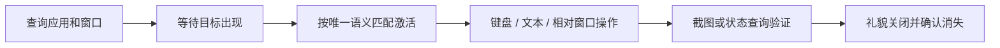
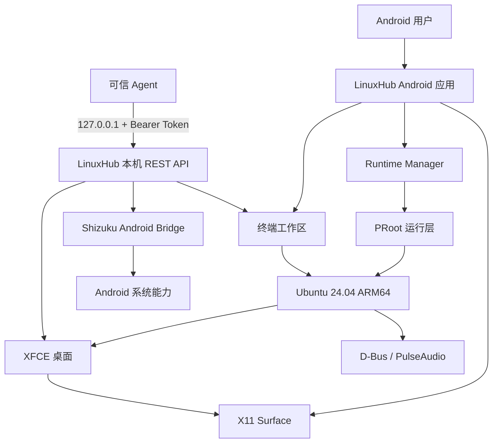

<h1 align="center">LinuxHub</h1>

<p align="center">
  <strong>把 Android 变成一台完整的 Linux 工作站，也变成 Agent 可以直接操作的本地电脑。</strong>
</p>

<p align="center">
  Ubuntu 24.04 · XFCE · PRoot · 中文桌面 · 本机 Agent · Shizuku Android Bridge
</p>

<p align="center">
  <b>简体中文</b> ·
  <a href="README_EN.md">English</a> ·
  <a href="ARCHITECTURE.md">技术架构</a> ·
  <a href="CHANGELOG.md">更新记录</a> ·
  <a href="CONTRIBUTING.md">参与贡献</a> ·
  <a href="SECURITY.md">安全策略</a>
</p>

<p align="center">
  
  
  
  
  
  
  
  
</p>

<p align="center">
  <sub>无需 Root · 不依赖远程虚拟机 · Agent 仅监听本机回环地址</sub>
</p>

---

## 一句话理解 LinuxHub

> **LinuxHub 在 Android 设备上提供一套可交互、可扩展、可被 Agent 调用的 Linux 桌面。**

它把原本分散的终端、Linux 桌面、图形窗口、鼠标键盘、Android 系统能力和自动化接口整合到同一个应用中。用户可以像使用普通 Linux 电脑一样操作桌面，也可以让可信 Agent 通过本机 REST API 完成连续任务。

| 桌面 | 运行时 | Agent |
|:---:|:---:|:---:|
| Ubuntu 24.04 + XFCE | PRoot + Termux:X11 | 本机 REST API + Token |
| 面向手机与平板的触控交互 | 不修改 Android 系统分区 | 终端、窗口、输入与 Android 桥统一调度 |
| 中文语言、字体与输入法 | D-Bus、PulseAudio 与共享存储 | 结构化调用、状态查询与操作后验证 |

## 为什么是 LinuxHub

### 完整的 Linux，而不是单个终端

LinuxHub 提供 Ubuntu 用户空间、XFCE 桌面、图形应用、音频链路、文件访问和常用桌面组件。终端是工作区的一部分，不是全部。

### 为 Android 设备重新设计交互

没有实体鼠标和键盘也能完成桌面操作。单指移动指针、轻点左键、长按右键、长按拖拽、双指滚动，并支持 Android 软键盘和外接输入设备。

### 中文从一开始就在桌面里

简体中文不是额外补丁。`zh_CN.UTF-8`、Noto CJK 字体、Fcitx5、桌面翻译、中文菜单、终端组合输入和 Agent UTF-8 文本输入形成一条完整链路。

### Agent 可以直接操作电脑

LinuxHub 内置仅监听 `127.0.0.1` 的 Agent API。Agent 可以枚举应用和窗口、启动桌面、截图裁切、移动鼠标、输入文字、执行终端命令，并在需要时调用 Shizuku 完成 Android 系统级操作。

### 本机执行，不需要云端虚拟机

任务在设备本地完成。Agent 通过回环地址连接 LinuxHub，不必开放公网端口，也不需要把桌面流媒体到远端服务器。

## 核心能力

| 能力域 | 已具备的能力 |
| --- | --- |
| Linux 环境 | Ubuntu 24.04 ARM64、PRoot、离线部署、完整性校验、初始化任务状态 |
| 图形桌面 | XFCE、Termux:X11、无头模式、显示尺寸查询、桌面启停与状态恢复 |
| 终端 | 多会话 PTY、真彩色、Unicode、中文显示、软键盘与常用编辑键 |
| 应用与窗口 | 枚举 `.desktop` 应用、启动程序、查询窗口、焦点、PID、几何与状态变化 |
| 图形自动化 | 截图、窗口裁切、鼠标、点击、拖拽、滚轮、按键、组合键和文本输入 |
| 剪贴板 | 读取、写入和清空 X11 `CLIPBOARD` |
| 浏览器协作 | 打开 URL 或路径，并使用用户当前浏览器设置的默认搜索引擎检索 |
| Android 桥 | Shizuku shell、截图、输入、文件推拉、APK 安装卸载与浏览器角色切换 |
| 中文桌面 | 中文 locale、CJK 字体、Fcitx5、桌面翻译、中文菜单与候选输入 |
| 本机 Agent | Bearer Token、工具目录、结构化调用、批处理、耗时与失败位置返回 |
| 命令行 | 容器内 `lotusctl`，无需额外安装 `curl` 即可调用 Agent |
| 移动交互 | 单指指针、左键、完整长按右键、拖拽、滚轮、软键盘与外设支持 |

## 本机 Agent

LinuxHub 的 Agent 服务把 Linux 桌面和 Android 系统能力暴露为一套本机结构化工具。任何能够发送带自定义 HTTP Header 请求的 Agent，都可以在用户授权后接入。

### 连接信息

```text
Endpoint:      http://127.0.0.1:38473
Authorization: Bearer <从 LinuxHub 设置中复制的 Token>
```

> [!IMPORTANT]
> Agent 服务只绑定 `127.0.0.1`。Token 在本机生成，只应提供给可信 Agent，不应写入截图、公开日志或远端配置。

### HTTP 接口

| 方法 | 路径 | 用途 |
| --- | --- | --- |
| `GET` | `/v1/health` | 查询 Agent 服务与运行环境状态 |
| `GET` | `/v1/tools` | 获取当前可用工具目录与参数定义 |
| `POST` | `/v1/tools/call` | 调用单个结构化工具 |
| `POST` | `/v1/cli/exec` | 通过 Agent 执行容器命令 |

### 快速验证

```bash
export LINUXHUB_TOKEN='<从设置中复制的 Token>'

curl -sS http://127.0.0.1:38473/v1/health \
  -H "Authorization: Bearer ${LINUXHUB_TOKEN}"

curl -sS http://127.0.0.1:38473/v1/tools \
  -H "Authorization: Bearer ${LINUXHUB_TOKEN}"
```

调用窗口工具：

```bash
curl -sS http://127.0.0.1:38473/v1/tools/call \
  -H "Authorization: Bearer ${LINUXHUB_TOKEN}" \
  -H 'Content-Type: application/json' \
  -d '{"tool":"desktop.windows","arguments":{}}'
```

### 容器内命令行

Ubuntu 环境内置 `/usr/local/bin/lotusctl`：

```bash
lotusctl health
lotusctl exec 'uname -a'
lotusctl desktop-start
lotusctl screenshot /tmp/desktop.png
lotusctl call '{"tool":"desktop.windows","arguments":{}}'
```

## Agent 工具矩阵

### 终端与系统

| 工具域 | 代表能力 |
| --- | --- |
| `terminal` | 执行命令，返回 stdout、stderr、退出码、耗时和截断状态 |
| `system` | 查询应用、Android、ABI、容器和运行环境信息 |
| `batch` | 顺序执行多项桌面动作，逐项返回结果与首个失败位置 |

### Linux 桌面

| 工具域 | 代表能力 |
| --- | --- |
| `desktop` | 启动、停止、查询 X11/XFCE 会话和桌面尺寸 |
| `desktop.apps` | 枚举 `.desktop` 应用并按应用 ID 启动 |
| `desktop.windows` | 查询标题、`WM_CLASS`、PID、几何、焦点和窗口状态 |
| `desktop.activate` | 按 `windowId`、标题、`WM_CLASS` 或 PID 激活窗口 |
| `desktop.close` | 礼貌关闭窗口并验证目标是否消失 |
| `desktop.screenshot` | 截取完整桌面或指定窗口，并按窗口相对区域裁切 |
| `desktop.mouse` | 移动、点击、双击、拖拽、滚轮和按键保持 |
| `desktop.key` | 普通按键、组合键和功能键 |
| `desktop.text` | 向当前 X11 焦点输入 UTF-8 文本 |
| `desktop.clipboard` | 读取、写入和清空 X11 剪贴板 |
| `desktop.open` | 打开绝对路径或 URL |
| `desktop.search` | 使用用户浏览器当前默认搜索引擎检索 |

### Android

| 工具域 | 代表能力 |
| --- | --- |
| `android.shell` | 通过 Shizuku 获得 shell 身份执行 Android 命令 |
| `android.screenshot` | 捕获 Android 屏幕 |
| `android.input` | 发送 Android 级输入事件 |
| `android.file` | 在 Android 与 Linux 工作区之间推拉文件 |
| `android.apk` | 安装或卸载 APK |
| `android.browser` | 查询或切换系统默认浏览器角色 |

## 图形界面自动化

LinuxHub 鼓励 Agent 使用语义选择器和真实状态验证，而不是始终依赖全屏截图与坐标猜测。



窗口选择支持：

- `windowId`
- 窗口标题
- `WM_CLASS`
- 进程 PID

如果选择器同时匹配多个窗口，接口会返回候选项，而不是静默操作错误目标。

## 中文桌面体验

LinuxHub 将中文环境作为默认桌面能力的一部分：

| 层面 | 实现 |
| --- | --- |
| 系统语言 | 默认生成 `zh_CN.UTF-8` locale |
| 字体 | 集成 Noto CJK，覆盖界面、终端和应用文本 |
| 输入法 | 集成 Fcitx5 与中文候选输入组件 |
| 桌面翻译 | 保留 XFCE Terminal、Thunar、面板、窗口管理器和设置程序的中文翻译 |
| 应用名称 | 桌面菜单与内置应用提供中文名称和说明 |
| 终端输入 | 支持中文显示、组合文本、候选提交、Backspace、Delete 和方向键 |
| Agent 输入 | `desktop.text` 直接提交 UTF-8，可向图形应用输入中文 |
| 焦点隔离 | Agent 输入与 Android 普通软键盘使用独立通道，不抢占用户键盘焦点 |

## 移动触控与外设

| 操作 | 行为 |
| --- | --- |
| 单指滑动 | 移动 Linux 光标 |
| 单指轻点 | 左键单击 |
| 单指长按 | 完整的右键按下与释放 |
| 长按后滑动 | 拖拽窗口或内容 |
| 双指滑动 | 垂直或水平滚动 |
| Android 软键盘 | 向当前 Linux 输入焦点提交按键与文本 |
| 外接鼠标 | 相对移动、左右键与滚轮 |
| 外接键盘 | 组合键、功能键、方向键和编辑键 |

桌面区域默认使用 `1280×800` 的 16:10 画布，并针对移动屏幕进行适配，不强制拉伸界面。首次初始化会写入默认壁纸、GTK 主题和图标主题，之后保留用户配置。

## 技术架构



### 运行组件

| 层级 | 组件 |
| --- | --- |
| Android 应用 | Kotlin、Jetpack Compose、终端界面、X11 Surface、运行时管理 |
| Linux 用户空间 | Ubuntu 24.04 ARM64、PRoot、用户与环境配置 |
| 桌面 | XFCE、X11、窗口管理器、GTK、图标主题和桌面组件 |
| 图形呈现 | 内嵌 X11 Runtime，基于 Termux:X11 / Lorie 显示链路 |
| 音频与桌面服务 | D-Bus、PulseAudio、Android 音频桥 |
| Android 特权桥 | Shizuku shell 身份，按需调用 |
| Agent | 本机 HTTP 服务、工具目录、Bearer 鉴权、结构化调度 |

## 快速开始

### 环境要求

- Android 8.0 或更高版本
- ARM64 Android 设备
- 足够的可用存储空间
- 需要 Android 系统级工具时安装并授权 Shizuku

### 启动 LinuxHub

1. 安装 LinuxHub APK。
2. 首次启动时创建 Linux 用户。
3. 保持 LinuxHub 在前台，等待 Ubuntu 环境部署完成。
4. 从首页进入终端，或启动 XFCE 桌面。
5. 在设置中启用本机 Agent，并复制 Endpoint 与 Token。
6. 将连接信息提供给可信 Agent，或使用 `lotusctl` 在本机验证。

> [!NOTE]
> 首次部署需要展开 RootFS 和初始化桌面环境。请预留足够空间，并在部署期间保持应用在前台。

### Shizuku

Shizuku 为 LinuxHub 提供受用户授权的 shell/ADB 身份：

- 不需要 Root
- 不需要外部 ADB server
- 不启用 Shizuku 时，Linux 终端、桌面和 X11 工具仍然可用
- 只有 `android.*` 工具域依赖 Shizuku

## 从源码构建

要求：

- JDK 17
- Android SDK
- Android NDK

```bash
./gradlew :app:testDebugUnitTest --no-daemon
./gradlew :app:assembleDebug --no-daemon
```

APK 输出：

```text
app/build/outputs/apk/debug/app-debug.apk
```

## 项目结构

```text
LinuxHub/
├── app/                      Android 应用、终端、X11 与 Linux 运行时
├── assets/                   README 与项目展示资源
├── termux_ubuntu_rebuild/    Ubuntu 与 Termux:X11 构建资源
├── tools/                    离线桌面主题、依赖与辅助工具
├── ARCHITECTURE.md           技术架构
├── OFFLINE_ASSETS.md         离线资源说明
├── SECURITY.md               安全策略
└── CHANGELOG.md              更新记录
```

## 安全模型

LinuxHub 将本机 Agent 视为高权限自动化接口，并按这个前提设计边界。

- API 仅监听 `127.0.0.1`，不向局域网开放。
- 每次工具调用都需要 Bearer Token。
- Token 不写入健康检查响应和运行日志。
- `android.shell` 继承 Shizuku shell 身份，只应向可信 Agent 开放。
- PRoot 是用户空间环境，不是用于运行敌对代码的硬件安全沙箱。
- Linux 程序可以访问显式绑定到容器的 Android 路径，请只运行可信软件。
- 不向不可信 Agent 提供 Token，也不在公开 Issue 中提交 Token、日志或设备隐私信息。

安全问题请通过 GitHub Security Advisory 私密报告，详见 [SECURITY.md](SECURITY.md)。

## 兼容性与边界

| 项目 | 说明 |
| --- | --- |
| Android | API 26 及以上 |
| CPU | ARM64 |
| Root | 不要求 |
| Shizuku | 可选；仅 Android 系统级工具依赖 |
| 桌面 | XFCE / X11 |
| 图形性能 | 取决于设备、Android 内核、Mesa 与图形驱动能力 |
| Agent | 本机 HTTP/REST，不开放局域网监听 |
| 数据位置 | Linux 环境保存在应用私有目录 |

## 参与贡献

- 提交 Bug 前，请先移除 Token、用户名、文件路径和设备隐私信息。
- 修改运行环境、输入、显示或 Android 桥时，请同时验证终端与图形桌面。
- 文档、翻译、兼容性测试和复现报告同样重要。
- 提交代码前请阅读 [CONTRIBUTING.md](CONTRIBUTING.md)。

## 开源许可

LinuxHub 以 [GNU General Public License v3.0](LICENSE) 发布。

Ubuntu、XFCE、Termux、Termux:X11、PRoot、Shizuku、Mesa、PulseAudio 及其他组件分别遵循其原始许可证与版权声明。详细说明见 [ACKNOWLEDGEMENTS.md](ACKNOWLEDGEMENTS.md)。

---

<p align="center">
  <strong>LinuxHub</strong><br>
  <sub>Android 上的 Linux 桌面，以及 Agent 可以直接操作的本地电脑。</sub>
</p>
