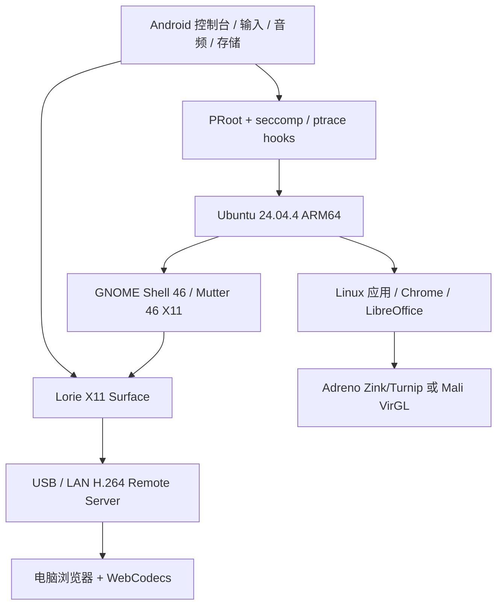

<h1 align="center">LinuxHub</h1>

  <strong>把 Android ARM64 设备变成一台完整的 Ubuntu GNOME 工作站。</strong>

  Ubuntu 24.04.4 · GNOME 46 · Lorie X11 · PRoot · Adreno / Mali · USB / 局域网远程桌面

  <b>简体中文</b> ·
  <a href="README_EN.md">English</a> ·
  <a href="ARCHITECTURE.md">技术架构</a> ·
  <a href="CHANGELOG.md">更新记录</a> ·
  <a href="CONTRIBUTING.md">参与贡献</a> ·
  <a href="SECURITY.md">安全策略</a>

  
  
  
  
  
  
  
  

  无需 Root · 本地运行 · 不依赖远程虚拟机

  

---

## LinuxHub 2.0 · Myth-Prometheus

> **LinuxHub 在 Android ARM64 设备本地运行真正的 Ubuntu GNOME 桌面，并提供双芯片 GPU、远程桌面、离线初始化和完整应用生态。**

本次正式版本使用 Ubuntu 24.04.4 ARM64、官方 GNOME Shell 46、Mutter 46 X11、Lorie X11、PRoot 和 Mesa 27。Android 负责图形上屏、输入、音频、存储和生命周期管理，Ubuntu 负责完整 Linux 用户空间与桌面应用。

| 版本 | 运行时 | 桌面 |
|:---:|:---:|:---:|
| `Myth-Prometheus` | Ubuntu 24.04.4 + PRoot + Lorie X11 | 官方 GNOME Shell 46 / Mutter 46 |
| Android 9+ ARM64 | 双芯片应用 GPU | USB / 局域网远程桌面 |
| `com.linuxhub.myth` | Zink / Turnip / VirGL | H.264 + WebCodecs |

## 核心能力

| 能力域 | 已具备的能力 |
| --- | --- |
| Linux 环境 | Ubuntu 24.04.4 ARM64、PRoot、APT、sudo、中文 locale、离线完整性校验 |
| GNOME 桌面 | 官方 GNOME Shell 46、Mutter 46 X11、Yaru、Ubuntu Dock、DING 桌面图标 |
| 桌面应用 | Nautilus、Settings、Terminal、Text Editor、LibreOffice、Chrome、Thunderbird 等 |
| 双芯片 GPU | 高通 Zink / Turnip，天玑 VirGL / virpipe，失败自动回退软件渲染 |
| 浏览器 | Chrome 默认 GPU 启动链，保留新窗口与无痕窗口 Desktop Action |
| 终端 | 多会话 PTY、真彩色、Unicode、中文显示、软键盘和常用编辑键 |
| 远程桌面 | USB / 局域网浏览器访问、HTTPS、配对码、H.264、自适应码率 |
| 文件与安装 | 共享存储、XDG 用户目录、`.deb` 安装器、APT 启动器刷新 |
| 音频 | PulseAudio → FIFO → Android `AudioTrack` 扬声器输出 |
| 移动交互 | 触摸板、直接触摸、指针捕获、外接键鼠、剪贴板和 PIP |
| 稳定性 | 首帧检测、Surface 空闲保活、进程看门狗、前台服务和崩溃日志 |

## 兼容钩子与桥接层

LinuxHub 2.0 的桌面不是简单启动一个终端，而是把 Android 与 glibc Ubuntu 之间缺失的能力逐层补齐。

| 兼容层 | 作用 |
| --- | --- |
| PRoot 系统调用钩子 | `ptrace` / `seccomp` 拦截、路径重写、假 root、UID/GID 兼容 |
| `fake_id0` | 让 Ubuntu 软件在用户空间容器内正确执行 root 文件操作 |
| ashmem → memfd | 把 Android 共享内存机制转换为 Ubuntu 可用实现 |
| `getifaddrs` 钩子 | `LD_PRELOAD` 拦截网络接口查询，把 Android 真实 IPv4 / IPv6 传给 Ubuntu |
| Rust getifaddrs bridge | Android helper 与 Ubuntu glibc client 通过私有 Unix Socket 和 `TIF1` 协议通信 |
| GNOME Resource Overlay | 对齐 GNOME 46 启动流程、会话模式和首帧可见性 |
| DING 扩展兼容 | 修复桌面图标、文件拖放与剪贴板交互 |
| X11 Present / VBlank | 修复缓冲提交、Damage、GPU 复制完成和窗口残影 |
| MediaCodec Surface 直连 | Xlorie 画面直接进入 Android 硬件 H.264 编码器 |
| 应用启动包装器 | 所有桌面应用统一经过 `doro-gpu-run`，自动选择厂商 GPU 或软件渲染 |
| PulseAudio FIFO 桥 | Ubuntu 音频流通过独立 FIFO 接入 Android 音频系统 |
| JNI / Rust sessiond | Android 与 Linux 会话控制、环境检查、helper 编排和重启策略 |

## 下载、联网与软件安装

下载能力通过浏览器、共享存储、CA 证书、XDG 目录和软件包安装器形成完整闭环。

| 环节 | 实现 |
| --- | --- |
| 默认浏览器 | Chrome 处理 `http`、`https`、HTML 和常见网页文件 |
| DNS / hosts | 自动修复 `localhost`、主机名和容器网络解析 |
| HTTPS | 离线安装 `openssl` 与 `ca-certificates`，生成系统 CA 信任库 |
| Android 存储 | `/storage/emulated/0` 绑定到容器，`/sdcard/Download` 可直接访问 |
| Linux 下载目录 | 自动生成 `~/Downloads`、GTK 书签和中文目录名称 |
| APT | 固定 Ubuntu 24.04 `noble` 软件源，避免跨发行版污染 |
| `.deb` 文件 | 自动关联 LinuxHub 软件包安装器，校验 ARM64 架构并使用 APT 安装 |
| 安装后处理 | APT `Post-Invoke` 钩子刷新桌面菜单、MIME 和 GPU 启动参数 |
| 应用迁移 | APK 覆盖升级按内容指纹补装新增或更新的 vendor 应用 |
| 终端信息卡 | `doro-fetch` 在窄屏下分两段显示 Ubuntu 标识和系统信息 |

## 双芯片 GPU

| 平台 | 应用渲染链 | 说明 |
| --- | --- | --- |
| 高通 Adreno | Mesa Zink + Turnip | GNOME Shell 保持 llvmpipe 软件合成，应用单独使用 Adreno |
| 天玑 Mali | virpipe + VirGL | Android 侧启动 VirGL server，Ubuntu 应用通过 `virpipe` 使用硬件 |
| GPU 失败 | llvmpipe | 自动回退，避免应用或桌面直接黑屏 |
| GTK4 高通兼容 | Cairo | 修复文件管理器、编辑器和标签页在 Zink 路径上的花纹 |

Mesa 27 修复高通 ARM64 设备读取 CPU 能力不正确、执行 SVE 指令导致的 `SIGILL`、首帧超时和无法进入 GNOME 桌面问题。

## USB / 局域网远程桌面

远程桌面由手机本机提供服务，不需要安装电脑客户端。

- USB：通过 ADB 端口转发后直接用浏览器访问
- 局域网：手机自动读取本地 IP，电脑访问 HTTPS 地址
- 配对：六位一次性配对码
- 视频：X11 直接渲染到 MediaCodec Surface，编码为 H.264
- 解码：电脑浏览器通过 WebCodecs 解码
- 输入：键盘、鼠标、触摸和滚轮
- 流控：根据延迟与队列积压调整码率、请求关键帧、丢弃过期帧
- 低延迟：编码器支持 `drop-input-frames` 时自动抑制积压输入

## 初始化与覆盖升级

- 图形化配置权限、GPU 线路、Linux 用户名和密码
- 初始化任务逐项显示进度、完成、失败、超时和失败原因
- 总超时与“长时间无输出”进程看门狗
- APK 覆盖安装保留 rootfs、用户目录和已有配置
- 新 APK 自动补齐 GNOME、Mesa 和 vendor 应用，不要求重新初始化
- 内容指纹避免每次桌面启动重复执行全量校验
- 修复软链接、硬链接、SUID/SGID 和合并 `/usr` 目录结构
- 首次初始化建议预留至少 5 GB 可用空间

## Android 控制台

- 首页实时显示 Ubuntu 版本、用户、设备、架构和 GPU 线路
- 显示内存、存储、网络、桌面分辨率和运行时间
- 直接进入终端、GNOME 桌面、USB 远程、局域网远程和关于页
- 液态玻璃卡片、局部玻璃工具栏和透明 LinuxHub 标识
- 桌面前台服务通知与一键强制停止
- 画中画、全屏、横竖屏、挖孔区域和保持屏幕常亮
- 每 120 秒刷新 Android 用户活动，避免长时间下载或编译时自动熄屏

## 技术架构

## 快速开始

1. 从 [Releases](https://github.com/xishanp/Linuxhub/releases) 下载 ARM64 APK。
2. 安装并授予文件访问、通知和电池优化权限。
3. 选择 Adreno 或 Mali GPU 线路。
4. 创建 Ubuntu 用户名和密码。
5. 保持 LinuxHub 在前台，等待离线初始化完成。
6. 从首页进入 GNOME 桌面或终端。

> [!NOTE]
> 首次初始化会展开 Ubuntu、GNOME 和桌面应用，具体耗时取决于设备存储与 CPU。请预留至少 5 GB 可用空间。

## 兼容性

| 项目 | 说明 |
| --- | --- |
| Android | API 28 / Android 9 及以上 |
| CPU | ARM64 |
| Root | 不要求 |
| 桌面 | 官方 GNOME Shell 46 / Mutter 46 X11 |
| GPU | Adreno、Mali，失败自动回退 llvmpipe |
| 远程桌面 | USB 或同一局域网 |
| 浏览器 | Chrome / Edge 109+ 等支持 WebCodecs 的浏览器 |
| 存储 | 应用私有 rootfs + Android 共享存储绑定 |

## 本版边界

- 浏览器硬件视频编码留到下一版本
- 正式 Chrome Wayland 产品启动链留到下一版本
- AAC / MP4 完整封装留到下一版本
- Wayland / Zink 下 Canvas 2D 左边缘残影仍待修复

## 参与贡献

- 提交问题前，请移除用户名、设备路径、Token 和其他隐私信息。
- 修改 X11、PRoot、GPU 或初始化链路时，请同时验证高通与天玑设备。
- 修改桌面启动器时，请确认终端启动和图标启动使用同一套 GPU 参数。
- 文档、翻译、兼容性测试和复现报告同样重要。

## 开源许可

LinuxHub 以 [GNU General Public License v3.0](LICENSE) 发布。

Ubuntu、GNOME、Mutter、PRoot、Termux:X11、Lorie、Mesa、PulseAudio 及其他组件分别遵循其原始许可证与版权声明。详细说明见 [ACKNOWLEDGEMENTS.md](ACKNOWLEDGEMENTS.md)。

---

  <strong>LinuxHub · Myth-Prometheus</strong> 
  Android 上的完整 Ubuntu GNOME 桌面。

