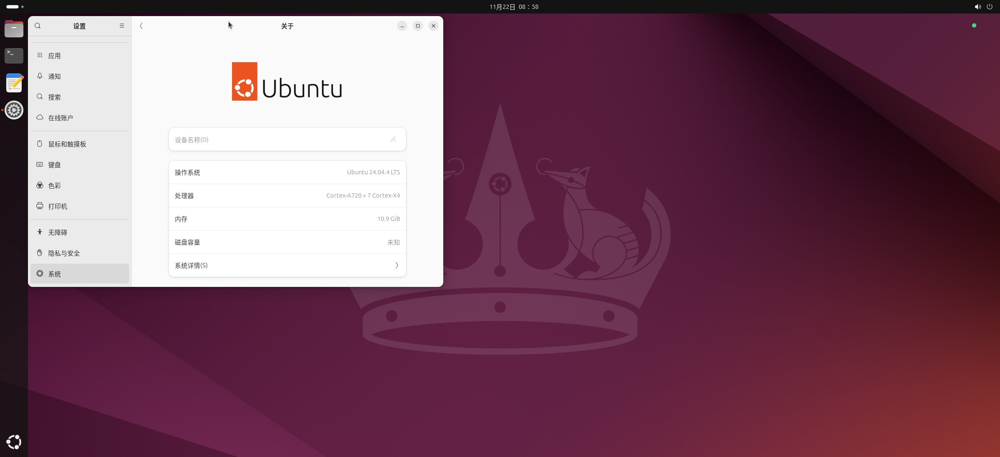

<h1 align="center">LinuxHub</h1>

<p align="center">
  <strong>在 Android ARM64 手机上运行完整 Ubuntu GNOME 工作站。</strong>
</p>

<p align="center">
  Ubuntu 24.04.4 · GNOME 46 · Lorie X11 · PRoot · Adreno / Mali · USB / 局域网远程桌面
</p>

<p align="center">
  <b>简体中文</b> ·
  <a href="README_EN.md">English</a> ·
  <a href="ARCHITECTURE.md">技术架构</a> ·
  <a href="CHANGELOG.md">更新记录</a> ·
  <a href="CONTRIBUTING.md">参与贡献</a> ·
  <a href="SECURITY.md">安全策略</a>
</p>

<p align="center">
  <a href="https://github.com/xishanp/Linuxhub/releases/tag/myth-prometheus"></a>
  
  
  
  
</p>

<p align="center">
  
  
  
  
  
  
</p>

<p align="center">
  <sub>无需 Root · Android 本地运行 · 不使用远程虚拟机 · 官方 GNOME 桌面</sub>
</p>

<p align="center">
  
</p>

---

## LinuxHub 2.0 · Myth-Prometheus

> **在 Android ARM64 手机上运行完整 Ubuntu GNOME 桌面，同时提供双芯片 GPU、兼容钩子、USB / 局域网远程桌面、离线初始化和完整应用安装链路。**

LinuxHub 2.0 是面向 Android ARM64 设备的正式版本。本次同时更新了桌面底座、双芯片 GPU、兼容钩子、初始化升级、下载联网、应用安装、远程桌面和界面交互。

| 发布信息 | 当前值 |
| --- | --- |
| 桌面家族 | `Myth` |
| 版本名 | `Myth-Prometheus` |
| 显示名 | `LinuxHub` |
| applicationId | `com.linuxhub.myth` |
| versionCode | `201` |
| 系统 | Android 9 / API 28 及以上 |
| 架构 | ARM64 |
| 桌面 | 官方 GNOME Shell 46 / Mutter 46 X11 |
| 运行时 | Ubuntu 24.04.4 ARM64 + PRoot + Lorie X11 |
| GPU | 高通 Adreno Zink / Turnip，天玑 Mali VirGL / virpipe |
| 分发 | [GitHub Releases](https://github.com/xishanp/Linuxhub/releases/tag/myth-prometheus) |

## 一、完整 Ubuntu GNOME 桌面

- Ubuntu 24.04.4 ARM64。
- 官方 GNOME Shell 46、Mutter 46、X11 合成器。
- 通过 Lorie X11、PRoot 在 Android 本地运行，不使用虚拟机。
- 完整中文环境、Yaru 主题、Ubuntu Dock、桌面图标、窗口管理。
- Nautilus 文件管理器、GNOME 设置、终端、文本编辑器、截图工具。
- LibreOffice、Chrome、Thunderbird、Evince、Remmina、Transmission、Rhythmbox、Totem、Shotwell、磁盘工具、系统监视器、归档管理器等常用应用。
- 离线包内置官方 Ubuntu GNOME DEB 集合，当前锁文件记录 729 个 DEB，覆盖桌面组件与依赖，不依赖初始化现场补包。

## 二、兼容钩子与桥接层

LinuxHub 不是简单启动一个终端或套一层仿桌面。Android 与 glibc Ubuntu 之间缺失的系统能力，由下列正式兼容入口逐层补齐。

### 1. PRoot 系统调用钩子

- 通过 `ptrace`、`seccomp` 拦截和修正容器系统调用。
- 路径重写，把 Ubuntu 根目录映射到 Android 应用私有目录。
- `fake_id0` 假 root 与 UID / GID 兼容。
- Android ashmem 到 memfd 的共享内存转换。
- 处理 Android 父进程 seccomp 策略拒绝的系统调用。
- 修复 PRoot 对读取 / 写入模式判断错误导致的 memfd 文件问题。
- 修复 Ubuntu 软链接、硬链接和合并 `/usr` 目录结构。
- 保留 SUID / SGID 语义，并处理覆盖升级后的文件类型修复。

### 2. getifaddrs 网络钩子

- 通过 `LD_PRELOAD` 拦截 Ubuntu 的 `getifaddrs()`。
- 把 Android 宿主真实网络接口传给容器。
- Rust Android helper 与 Ubuntu glibc client 通过私有 Unix Socket 通信。
- 自定义 `TIF1` + 长度协议，解决短读、断连和粘连数据。
- 修复 IPv6 `sockaddr_in6` 被错误截断的问题。
- 桥接不可用时自动回退 libc 原始实现，不会让所有程序启动失败。
- 每次终端和桌面启动都从 APK 刷新 client，覆盖升级不会残留旧版本。
- Rust `getifaddrs-bridge` 已替代旧 C 桥接实现。

### 3. GNOME Shell 兼容钩子

- 使用 `G_RESOURCE_OVERLAYS` 为 GNOME Shell 注入资源覆盖层。
- 对齐 GNOME 46 的启动流程、首帧可见性和会话模式。
- 增加桌面首帧、Shell 可见性和启动完成状态诊断。
- 修复 DING 桌面图标扩展的剪贴板与文件拖放兼容。
- 使用独立的 LinuxHub GNOME session mode。
- 提供私有 session D-Bus 和 system D-Bus。
- 支持停止、重新启动和失败日志采集。

### 4. 应用启动钩子

- 启动器统一经过 `doro-gpu-run`。
- 高通应用自动进入 Zink / Turnip。
- 天玑应用自动进入 VirGL / virpipe。
- GPU 启动失败自动回退软件渲染。
- Chrome 使用专用 `doro-chrome` 启动器。
- 桌面快捷方式、终端命令和 APK 默认启动路径使用同一套参数。
- Chrome 新窗口、无痕窗口的 Desktop Action 参数会保留。
- APT 安装完成后自动刷新全部桌面启动器。

### 5. X11 / Lorie 显示与输入钩子

- 修改 Xserver 的 Present、VBlank、Damage 和缓冲提交路径。
- 支持无头桌面与 SurfaceView 显示之间切换。
- 支持把 X11 画面直接送入 MediaCodec Surface。
- 增加 GPU 复制完成、缓冲回收和残帧处理。
- 空闲 Surface 每秒提交一帧保活。
- 触摸、鼠标、滚轮、键盘和软键盘统一注入 X11。
- 支持指针捕获、手写笔、触摸板和模拟触摸。
- X11 Server 与桌面会话生命周期绑定，停止后清理残留进程。

### 6. 音频桥

- Ubuntu PulseAudio 使用 `module-pipe-sink`。
- PCM 音频通过 FIFO 进入 Android。
- Android 使用 `AudioTrack` 输出到手机扬声器。
- 音频桥独立运行，失败不会拖垮 GNOME 桌面。
- 顶部栏可显示 Android 电池电量。

## 三、下载、联网与安装链路

这次把下载后“能落盘、能找到、能打开、能安装”的整条链路接通了。

| 阶段 | 实现 |
| --- | --- |
| 默认浏览器 | Chrome 是 `http`、`https` 和 HTML 文件的默认处理程序 |
| 浏览器窗口 | 支持普通窗口和无痕窗口，保留 Desktop Action 参数 |
| 用户目录 | 建立标准 XDG“下载、文档、图片、音乐、视频”目录 |
| 中文目录 | GTK 文件管理器显示中文目录名称 |
| Android 共享存储 | `/storage/emulated/0` 直接绑定到容器 |
| 路径兼容 | `/sdcard` 和 `/sdcard/Download` 可在 Ubuntu 中访问 |
| Android → Linux | Android 下载的文件可以直接在 Linux 文件管理器中打开 |
| Linux → Android | Linux 下载或生成的文件可以通过 `/sdcard` 带回 Android |
| HTTPS | 离线补齐 `openssl` 与 `ca-certificates`，自动生成 CA 信任库 |
| 域名解析 | 修复 `/etc/hosts`、主机名和 `localhost` 解析 |
| APT 源 | 固定为 Ubuntu 24.04 `noble`，避免混入其他发行版 |
| `.deb` 安装 | 自动关联 LinuxHub 软件包安装器 |
| 安装校验 | 安装前检查 ARM64、包名、版本和系统 `apt-get` |
| 安装后处理 | 通过 APT `Post-Invoke` 钩子刷新应用菜单 |
| 第三方应用 | 安装后自动补 GPU 启动参数和 MIME 关联 |
| APK 升级迁移 | 按内容指纹补装新增或更新的 vendor 应用 |
| 重复校验控制 | 后续桌面启动不会重复执行已经完成的全量校验 |

`doro-fetch` 不是下载器，而是终端里的系统信息欢迎卡。本版改成适配手机窄屏的两段式显示，并增加 fastfetch 不可用时的纯文本回退。

## 四、双芯片 GPU 与浏览器

| 平台 | 应用渲染链 | 本版策略 |
| --- | --- | --- |
| 高通 Adreno | Mesa Zink + Turnip | 应用使用 Adreno 硬件链路，GNOME Shell 保持 llvmpipe 软件合成 |
| 天玑 Mali | VirGL + virpipe | Android 侧启动 VirGL server，Ubuntu 应用通过 virpipe 使用硬件 |
| GPU 异常 | llvmpipe | 自动回退，避免桌面或应用直接黑屏 |
| 高通 GTK4 | Cairo | 修复文件管理器、编辑器和标签页的花纹与损坏区域 |

- Mesa 升级到 27，修复高通 AArch64 CPU 能力读取错误、SVE 非法指令导致的 `SIGILL` 和首帧超时。
- Chrome 默认启动器不再禁用 GPU。
- Chrome 的 Canvas、Compositing、Rasterization、Video Decode、WebGL、WebGPU 使用 GPU 渲染。
- 浏览器硬件视频编码保留到下一版本。

## 五、USB 与局域网远程桌面

- 电脑通过浏览器直接连接手机桌面，不安装客户端。
- 支持 USB 端口转发和同一局域网访问。
- 支持 HTTPS、自签名证书和六位配对码。
- macOS 和 Windows 提供一键连接命令。
- X11 画面直接渲染到 MediaCodec Surface。
- Android 硬件 H.264 编码。
- 浏览器通过 WebCodecs 解码。
- 支持键盘、鼠标、触摸、滚轮和动态画面尺寸。
- 根据延迟和积压自动调整码率。
- 队列拥塞时丢弃旧帧并请求关键帧。
- 支持 `drop-input-frames`，降低远程操作积压延迟。

## 六、初始化与覆盖升级

- 图形化配置权限、GPU 线路、Linux 用户名和密码。
- 初始化任务逐项显示完成、失败、超时及具体原因。
- 总超时和“长时间无输出”进程看门狗。
- 安装取消或失败后保留可恢复状态。
- APK 覆盖安装保留 rootfs、用户目录和已有配置。
- 新增或更新的 GNOME、Mesa、vendor 应用会自动补齐。
- 运行资源按 APK 内容版本刷新，不要求重新初始化。
- 修复根文件系统软链接、硬链接、SUID / SGID 和合并 `/usr`。
- 修复旧版本残留的过时组件。
- 首次初始化建议预留至少 5 GB 空间。

## 七、Android 控制台与界面

- 新的 LinuxHub 首页仪表盘。
- 显示 Ubuntu 版本、用户、设备、架构和 GPU 线路。
- 实时显示内存、存储、网络和桌面状态。
- 显示桌面分辨率、运行时间和远程连接人数。
- 首页直接进入终端、桌面、USB 远程、局域网远程和关于页。
- 液态玻璃视觉、局部玻璃工具栏和透明 LinuxHub 标识。
- 桌面服务使用前台通知，可直接强制停止。
- 支持画中画、全屏、横竖屏和挖孔区域。
- 支持保持屏幕常亮。
- 每 120 秒刷新一次 Android 用户活动，避免两三分多钟自动熄屏。

## 八、X11 输入与显示设置

- 原生分辨率、缩放、精确分辨率和自定义分辨率。
- 最近邻、双线性过滤。
- 键盘弹出时压缩显示。
- 触摸板、模拟触摸、直接触摸。
- 指针速度、指针捕获和捕获方向转换。
- 手写笔作为鼠标。
- 硬件键盘兼容、扫描码、DeX Meta 键和字符输入。
- 剪贴板同步。
- 上滑、下滑和返回键动作配置。

## 九、稳定性修复

- 高通厂商 GID 组名缺失时自动补 `/etc/group`。
- 修复 `su` 后 `groups: cannot find name` 长串报错。
- Lorie 空闲每秒一帧，解决 Oplus 三秒 Surface 缓冲告警。
- 修复首帧超时和 GNOME 窗口不可见。
- 修复桌面停止后 X11 进程残留。
- 修复初始化看门狗“最近活动”时间不更新。
- 修复 Chrome、LibreOffice 等应用启动环境和共享库冲突。
- Rust `linuxhub-sessiond` 负责启动计划、环境检查、helper 编排和会话重启。
- Rust `getifaddrs-bridge` 替代旧 C 桥接。
- Release 构建强制带上新版 Xlorie，避免误打包旧 native 库。

## 十、版本与发布

- 显示名：`LinuxHub`
- GNOME 桌面家族：`Myth`
- 版本名：`Myth-Prometheus`
- 包名：`com.linuxhub.myth`
- versionCode：`201`
- 仅 ARM64
- APK Signature Scheme v3 签名
- 安装包约 990 MB
- 通过 GitHub Releases 直接分发，不上 Google Play

当前发布文件：`LinuxHub-Myth-Prometheus.apk`

```text
SHA-256: 0aa2d258510b19ce2b909863db9edeabfe10ad2a34314cd21a8d2c45c3cefea2
证书 SHA-256: dc82aff0c06fdef4df5df54befbb79a0446a5ef95741c4f4ad18e0455b4fea10
```

## 技术架构


## 快速开始

1. 从 [Releases](https://github.com/xishanp/Linuxhub/releases) 下载 ARM64 APK。
2. 安装并授予文件访问、通知和电池优化权限。
3. 选择高通 Adreno 或天玑 Mali GPU 线路。
4. 创建 Ubuntu 用户名和密码。
5. 保持 LinuxHub 在前台，等待离线初始化完成。
6. 从首页进入 GNOME 桌面、终端或远程桌面。

> [!NOTE]
> 首次初始化会展开 Ubuntu、GNOME 和桌面应用，具体耗时取决于设备存储与 CPU。请预留至少 5 GB 可用空间。

## 兼容性

| 项目 | 说明 |
| --- | --- |
| Android | API 28 / Android 9 及以上 |
| CPU | ARM64 |
| Root | 不要求 |
| 桌面 | 官方 GNOME Shell 46 / Mutter 46 X11 |
| GPU | Adreno、Mali，失败自动回退 llvmpipe |
| 远程桌面 | USB 或同一局域网 |
| 浏览器 | Chrome / Edge 109+ 等支持 WebCodecs 的浏览器 |
| 存储 | 应用私有 rootfs + Android 共享存储绑定 |

## 本版边界

- 浏览器硬件视频编码留到下一版本。
- 正式 Chrome Wayland 产品启动链留到下一版本。
- AAC / MP4 完整封装留到下一版本。
- Wayland / Zink 下 Canvas 2D 左边缘残影仍待修复。

## 更多文档

- [技术架构](ARCHITECTURE.md)
- [离线资源清单](OFFLINE_ASSETS.md)
- [更新记录](CHANGELOG.md)
- [参与贡献](CONTRIBUTING.md)
- [安全策略](SECURITY.md)
- [第三方组件致谢](ACKNOWLEDGEMENTS.md)

## 开源许可

LinuxHub 以 [GNU General Public License v3.0](LICENSE) 发布。

Ubuntu、GNOME、Mutter、PRoot、Termux:X11、Lorie、Mesa、PulseAudio 及其他组件分别遵循其原始许可证与版权声明。详细说明见 [ACKNOWLEDGEMENTS.md](ACKNOWLEDGEMENTS.md)。

---

<p align="center">
  <strong>LinuxHub · Myth-Prometheus</strong><br>
  <sub>Android ARM64 上的完整 Ubuntu GNOME 桌面。</sub>
</p>
