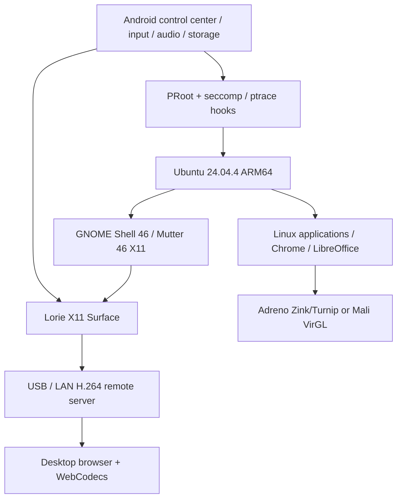

<h1 align="center">LinuxHub</h1>

<p align="center">
  <strong>A complete Ubuntu GNOME workstation running locally on Android ARM64 devices.</strong>
</p>

<p align="center">
  Ubuntu 24.04.4 · GNOME 46 · Lorie X11 · PRoot · Adreno / Mali · USB / LAN remote desktop
</p>

<p align="center">
  <a href="README.md">简体中文</a> ·
  <b>English</b> ·
  <a href="ARCHITECTURE.md">Architecture</a> ·
  <a href="CHANGELOG.md">Changelog</a> ·
  <a href="CONTRIBUTING.md">Contributing</a> ·
  <a href="SECURITY.md">Security</a>
</p>

<p align="center">
  <a href="https://github.com/xishanp/Linuxhub/releases/tag/myth-prometheus"></a>
  
  
  
  
</p>

<p align="center">
  
  
  
  
  
  
</p>

<p align="center">
  <sub>No Root required · Runs locally on Android · No remote virtual machine · Official GNOME desktop</sub>
</p>

<p align="center">
  <a href="assets/screenshots/09-gnome-desktop.jpg">View the LinuxHub 2.0 Ubuntu 24.04 GNOME 46 desktop screenshot</a>
</p>

---

## LinuxHub 2.0 · Myth-Prometheus

> **A complete Ubuntu GNOME desktop running locally on Android ARM64 devices, with dual-vendor GPU acceleration, compatibility hooks, USB / LAN remote desktop, offline initialization, and a complete package installation path.**

LinuxHub 2.0 is the production release for Android ARM64 devices. This release updates the desktop foundation, dual-vendor GPU support, compatibility hooks, initialization and upgrade flow, networking and downloads, package installation, remote desktop, and mobile interface.

| Release information | Current value |
| --- | --- |
| Desktop family | `Myth` |
| Version | `Myth-Prometheus` |
| Display name | `LinuxHub` |
| applicationId | `com.linuxhub.myth` |
| versionCode | `201` |
| System | Android 9 / API 28 or newer |
| Architecture | ARM64 |
| Desktop | Official GNOME Shell 46 / Mutter 46 X11 |
| Runtime | Ubuntu 24.04.4 ARM64 + PRoot + Lorie X11 |
| GPU | Qualcomm Adreno Zink / Turnip, MediaTek Mali VirGL / virpipe |
| Distribution | [GitHub Releases](https://github.com/xishanp/Linuxhub/releases/tag/myth-prometheus) |

## 1. Complete Ubuntu GNOME desktop

- Ubuntu 24.04.4 ARM64.
- Official GNOME Shell 46, Mutter 46, and X11 compositor.
- Runs locally on Android through Lorie X11 and PRoot, without a virtual machine.
- Complete Chinese environment, Yaru theme, Ubuntu Dock, desktop icons, and window management.
- Nautilus, GNOME Settings, Terminal, Text Editor, and screenshot tools.
- LibreOffice, Chrome, Thunderbird, Evince, Remmina, Transmission, Rhythmbox, Totem, Shotwell, Disks, System Monitor, Archive Manager, and other common applications.
- The offline package embeds the official Ubuntu GNOME DEB set. The current lock file records 729 DEBs covering desktop components and their dependencies, with no need to fetch packages during initialization.

## 2. Compatibility hooks and bridges

LinuxHub is not a terminal wrapper or an imitation desktop. The missing capabilities between Android and the glibc Ubuntu user space are supplied by the following production compatibility layers.

### 2.1 PRoot syscall hooks

- Intercept and correct container syscalls through `ptrace` and `seccomp`.
- Rewrite paths so the Ubuntu root directory maps into Android app-private storage.
- Provide `fake_id0` root semantics and UID / GID compatibility.
- Translate Android ashmem into memfd-backed shared memory.
- Handle syscalls rejected by the Android parent process seccomp policy.
- Fix PRoot read / write mode detection that previously broke memfd files.
- Repair Ubuntu symlink, hardlink, and merged `/usr` directory structures.
- Preserve SUID / SGID semantics and repair file types after overwrite upgrades.

### 2.2 getifaddrs network hook

- Intercept Ubuntu `getifaddrs()` through `LD_PRELOAD`.
- Expose the Android host's real network interfaces to the container.
- Use a private Unix socket between the Rust Android helper and the Ubuntu glibc client.
- Use a custom length-prefixed `TIF1` protocol to handle short reads, disconnects, and coalesced data.
- Fix truncation of IPv6 `sockaddr_in6` data.
- Fall back to the original libc implementation when the bridge is unavailable.
- Refresh the client from the APK on every terminal and desktop start, so overwrite upgrades cannot retain an old client.
- Replace the legacy C bridge with the Rust `getifaddrs-bridge`.

### 2.3 GNOME Shell compatibility hooks

- Inject a resource overlay into GNOME Shell through `G_RESOURCE_OVERLAYS`.
- Align GNOME 46 startup, first-frame visibility, and session mode.
- Expose diagnostics for desktop first frame, Shell visibility, and startup completion.
- Fix DING desktop-icon clipboard and file drag-and-drop compatibility.
- Use a dedicated LinuxHub GNOME session mode.
- Provide private session D-Bus and system D-Bus.
- Support stop, restart, and failure-log collection.

### 2.4 Application launch hooks

- Route all desktop launchers through `doro-gpu-run`.
- Select Zink / Turnip automatically on Qualcomm Adreno.
- Select VirGL / virpipe automatically on MediaTek Mali.
- Fall back to software rendering when the selected GPU path fails.
- Launch Chrome through the dedicated `doro-chrome` wrapper.
- Use the same GPU parameters from desktop shortcuts, terminal commands, and APK launch paths.
- Preserve Desktop Action arguments for normal and incognito Chrome windows.
- Refresh all desktop launchers after APT package installation.

### 2.5 X11 / Lorie display and input hooks

- Patch Xserver Present, VBlank, Damage, and buffer submission paths.
- Switch between headless desktop and SurfaceView presentation.
- Send X11 frames directly into a MediaCodec Surface.
- Track GPU-copy completion, buffer recycling, and stale-frame handling.
- Submit one keepalive frame per second when the Surface is idle.
- Inject touch, mouse, wheel, keyboard, and soft-keyboard input into X11.
- Support pointer capture, stylus input, touchpad mode, and simulated touch.
- Bind the X11 server to the desktop session lifecycle and clean up stopped sessions.

### 2.6 Audio bridge

- Use PulseAudio `module-pipe-sink` inside Ubuntu.
- Send PCM audio through a FIFO into Android.
- Output audio through Android `AudioTrack` to the phone speaker.
- Keep the audio bridge isolated so a failure cannot bring down GNOME.
- Display Android battery level in the top bar.

## 3. Download, networking, and package installation

This release connects the complete path from browser download to locating, opening, and installing the file.

| Stage | Implementation |
| --- | --- |
| Default browser | Chrome handles `http`, `https`, and HTML files |
| Browser windows | Normal and incognito windows preserve their Desktop Action arguments |
| User directories | Standard XDG Downloads, Documents, Pictures, Music, and Videos directories |
| Localized names | GTK file manager displays Chinese directory names |
| Android shared storage | Bind `/storage/emulated/0` directly into the container |
| Path compatibility | `/sdcard` and `/sdcard/Download` are available inside Ubuntu |
| Android to Linux | Files downloaded on Android open directly in the Linux file manager |
| Linux to Android | Files downloaded or generated in Linux can return through `/sdcard` |
| HTTPS | Bundle `openssl` and `ca-certificates`, then rebuild the CA trust store |
| Name resolution | Repair `/etc/hosts`, hostname, and `localhost` resolution |
| APT sources | Pin the Ubuntu 24.04 `noble` repositories |
| `.deb` files | Open through the LinuxHub package installer |
| Install checks | Validate ARM64, package identity, version, and system `apt-get` before installation |
| Post-install | APT `Post-Invoke` hooks refresh application menus |
| Third-party apps | Add GPU launch parameters and MIME associations after installation |
| APK upgrade migration | Install new or updated vendor applications using content fingerprints |
| Repeated validation | Avoid rerunning completed full validation on every desktop start |

`doro-fetch` is not a downloader. It is the terminal system-information welcome card. This release adds a two-stage layout for narrow phone screens and a plain-text fallback when fastfetch is unavailable.

## 4. Dual-vendor GPU and browser

| Platform | Application renderer | Release strategy |
| --- | --- | --- |
| Qualcomm Adreno | Mesa Zink + Turnip | Applications use the Adreno path while GNOME Shell remains on llvmpipe composition |
| MediaTek Mali | VirGL + virpipe | The Android-side VirGL server provides hardware rendering to Ubuntu applications |
| GPU failure | llvmpipe | Automatic fallback prevents a black desktop or application |
| Qualcomm GTK4 | Cairo | Fixes corrupted tabs and damaged regions in Nautilus, editors, and other GTK4 apps |

- Mesa 27 fixes incorrect Qualcomm AArch64 CPU feature detection, SVE `SIGILL`, first-frame timeout, and failure to enter GNOME.
- The default Chrome launcher no longer disables GPU acceleration.
- Chrome uses GPU rendering for Canvas, Compositing, Rasterization, Video Decode, WebGL, and WebGPU.
- Browser hardware video encoding is deferred to the next release.

## 5. USB and LAN remote desktop

- Connect from a computer browser without installing a client.
- Support USB port forwarding and access over the same LAN.
- Support HTTPS, a self-signed certificate, and a six-digit pairing code.
- Provide one-command connection helpers for macOS and Windows.
- Render X11 output directly into a MediaCodec Surface.
- Encode with Android hardware H.264.
- Decode in the browser through WebCodecs.
- Support keyboard, mouse, touch, wheel, and dynamic frame dimensions.
- Adapt bitrate to measured latency and queue pressure.
- Drop stale frames and request keyframes when the queue is congested.
- Support `drop-input-frames` to reduce accumulated remote-input latency.

## 6. Initialization and overwrite upgrades

- Guided configuration for permissions, GPU route, Linux username, and password.
- Per-task progress, completion, failure, timeout, and diagnostic reason.
- Total timeout plus a no-output process watchdog.
- Preserve a recoverable state when installation is cancelled or fails.
- Overwrite installation preserves the rootfs, user directories, and existing configuration.
- Automatically add new or updated GNOME, Mesa, and vendor applications.
- Refresh runtime resources by APK content version without requiring a new initialization.
- Repair rootfs symlinks, hardlinks, SUID / SGID semantics, and merged `/usr`.
- Remove obsolete components left by older releases.
- Recommend at least 5 GB of free storage for the first initialization.

## 7. Android control center and interface

- New LinuxHub home dashboard.
- Ubuntu version, user, device, architecture, and GPU route.
- Live memory, storage, network, and desktop status.
- Desktop resolution, uptime, and remote connection count.
- Direct access to Terminal, Desktop, USB Remote, LAN Remote, and About.
- Liquid-glass visuals, local glass toolbars, and a transparent LinuxHub mark.
- Foreground desktop notification with an immediate force-stop action.
- Picture-in-picture, fullscreen, orientation, and display-cutout support.
- Keep-awake control.
- Android user activity refreshed every 120 seconds to prevent screen sleep after two to three minutes.

## 8. X11 input and display settings

- Native resolution, scaling, exact resolution, and custom resolution.
- Nearest-neighbor and bilinear filtering.
- Compress the display when the keyboard opens.
- Touchpad, simulated touch, and direct touch modes.
- Pointer speed, pointer capture, and capture-direction transforms.
- Stylus input as a mouse.
- Hardware keyboard compatibility, scancodes, DeX Meta key, and character input.
- Clipboard synchronization.
- Configurable swipe-up, swipe-down, and Back actions.

## 9. Stability fixes

- Fill missing Qualcomm vendor GID names in `/etc/group`.
- Fix the long `groups: cannot find name` error after `su`.
- Submit one Lorie frame per second while idle to avoid Oplus three-second Surface buffer warnings.
- Fix first-frame timeout and invisible GNOME windows.
- Clean up X11 processes after stopping the desktop.
- Refresh the initialization watchdog “latest activity” timestamp.
- Fix launch environments and shared-library conflicts for Chrome, LibreOffice, and other applications.
- Use Rust `linuxhub-sessiond` for startup planning, environment checks, helper orchestration, and session restart.
- Replace the legacy C getifaddrs bridge with Rust `getifaddrs-bridge`.
- Force the release build to package the current Xlorie native library instead of an old copy.

## 10. Version and release

- Display name: `LinuxHub`
- GNOME desktop family: `Myth`
- Version: `Myth-Prometheus`
- Package: `com.linuxhub.myth`
- versionCode: `201`
- Architecture: ARM64 only
- Signing: APK Signature Scheme v3
- APK size: approximately 990 MB
- Distribution: GitHub Releases, not Google Play

Current release file: `LinuxHub-Myth-Prometheus-groups.apk`

```text
SHA-256: 0aa2d258510b19ce2b909863db9edeabfe10ad2a34314cd21a8d2c45c3cefea2
Certificate SHA-256: dc82aff0c06fdef4df5df54befbb79a0446a5ef95741c4f4ad18e0455b4fea10
```

## Architecture



## Quick start

1. Download the ARM64 APK from [Releases](https://github.com/xishanp/Linuxhub/releases).
2. Install it and grant file access, notification, and battery-optimization permissions.
3. Select the Qualcomm Adreno or MediaTek Mali GPU route.
4. Create the Ubuntu username and password.
5. Keep LinuxHub in the foreground while offline initialization completes.
6. Open GNOME Desktop, Terminal, or Remote Desktop from the home page.

> [!NOTE]
> The first initialization expands Ubuntu, GNOME, and desktop applications. Time depends on device storage and CPU. Reserve at least 5 GB of free space.

## Compatibility

| Item | Requirement |
| --- | --- |
| Android | API 28 / Android 9 or newer |
| CPU | ARM64 |
| Root | Not required |
| Desktop | Official GNOME Shell 46 / Mutter 46 X11 |
| GPU | Adreno or Mali with automatic llvmpipe fallback |
| Remote desktop | USB or the same LAN |
| Browser | Chrome / Edge 109+ or another browser with WebCodecs |
| Storage | App-private rootfs plus Android shared-storage bindings |

## Current boundaries

- Browser hardware video encoding is deferred to the next release.
- A production Chrome Wayland launch path is deferred to the next release.
- AAC / MP4 packaging is deferred to the next release.
- The Canvas 2D left-edge artifact under Wayland / Zink remains unresolved.

## More documentation

- [Architecture](ARCHITECTURE.md)
- [Offline asset inventory](OFFLINE_ASSETS.md)
- [Changelog](CHANGELOG.md)
- [Contributing](CONTRIBUTING.md)
- [Security policy](SECURITY.md)
- [Third-party acknowledgements](ACKNOWLEDGEMENTS.md)

## License

LinuxHub is released under the [GNU General Public License v3.0](LICENSE).

Ubuntu, GNOME, Mutter, PRoot, Termux:X11, Lorie, Mesa, PulseAudio, and other components retain their original licenses and copyright notices. See [ACKNOWLEDGEMENTS.md](ACKNOWLEDGEMENTS.md).

---

<p align="center">
  <strong>LinuxHub · Myth-Prometheus</strong><br>
  <sub>A complete Ubuntu GNOME desktop on Android ARM64.</sub>
</p>
