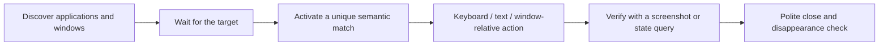
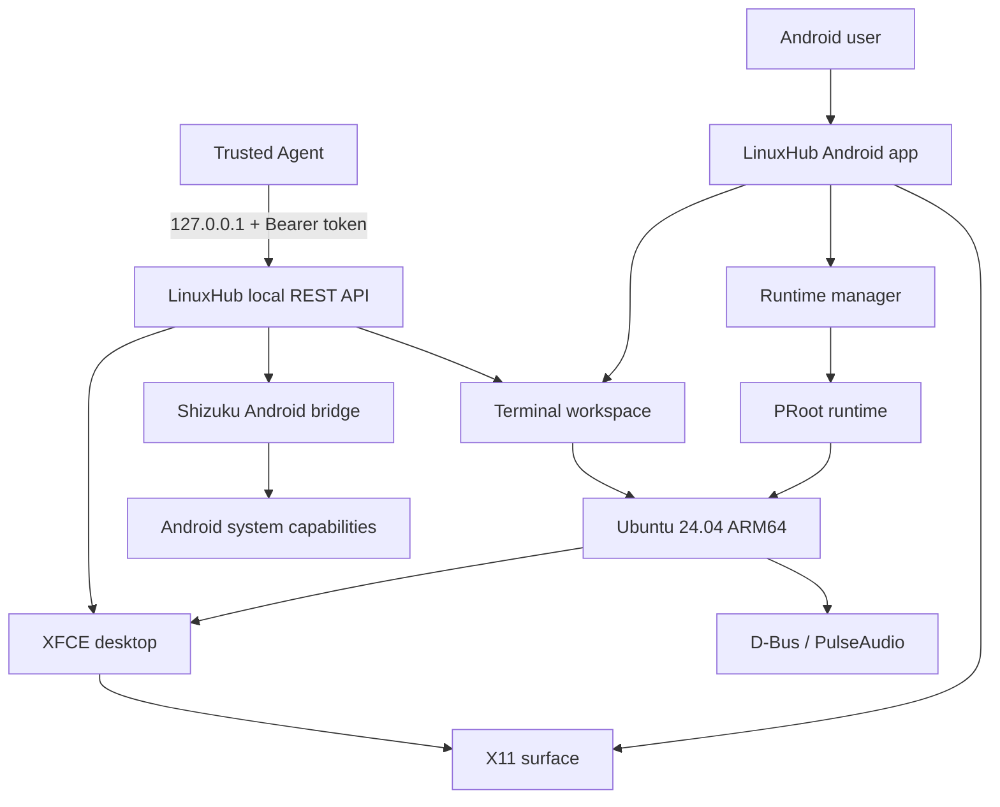

<h1 align="center">LinuxHub</h1>

<p align="center">
  <strong>A complete Linux workstation on Android — and a local computer that Agents can operate directly.</strong>
</p>

<p align="center">
  Ubuntu 24.04 · XFCE · PRoot · Chinese Desktop · Local Agent · Shizuku Android Bridge
</p>

<p align="center">
  <a href="README.md">简体中文</a> ·
  <b>English</b> ·
  <a href="ARCHITECTURE.md">Architecture</a> ·
  <a href="CHANGELOG.md">Changelog</a> ·
  <a href="CONTRIBUTING.md">Contributing</a> ·
  <a href="SECURITY.md">Security</a>
</p>

<p align="center">
  
  
  
  
  
  
  
  
</p>

<p align="center">
  <sub>No Root required · No remote VM dependency · Agent bound to loopback only</sub>
</p>

---

## LinuxHub in one sentence

> **LinuxHub brings an interactive, extensible Linux desktop to Android and exposes it to trusted Agents through a local control surface.**

It unifies the terminal, Linux desktop, application windows, pointer and keyboard input, Android system capabilities, and automation APIs in one application. Users can work with LinuxHub like a regular Linux computer; trusted Agents can also execute multi-step workflows through the local REST API.

| Desktop | Runtime | Agent |
|:---:|:---:|:---:|
| Ubuntu 24.04 + XFCE | PRoot + Termux:X11 | Local REST API + Token |
| Touch-first interaction for phones and tablets | Android system partitions remain untouched | Unified terminal, window, input, and Android bridge |
| Chinese locale, fonts, and input method | D-Bus, PulseAudio, and shared storage | Structured calls, state queries, and post-action verification |

## Why LinuxHub

### A Linux workspace, not just a terminal

LinuxHub provides an Ubuntu userspace, the XFCE desktop, graphical applications, audio, file access, and essential desktop components. The terminal is one part of the workspace, not the whole product.

### Built for Android interaction

The desktop remains usable without a physical mouse or keyboard. One-finger movement controls the pointer, tap sends a left click, long press sends a right click, long press and move performs drag, and two-finger gestures scroll. Android soft keyboards and external input devices are supported.

### Chinese support from the desktop foundation up

Simplified Chinese is not an add-on patch. `zh_CN.UTF-8`, Noto CJK fonts, Fcitx5, desktop translations, Chinese menus, composed terminal input, and Agent UTF-8 text entry form one complete path.

### An Agent-operable computer

LinuxHub includes a local Agent API bound only to `127.0.0.1`. An Agent can enumerate applications and windows, start the desktop, capture and crop screenshots, move the pointer, enter text, execute terminal commands, and call Shizuku when Android system-level operations are required.

### Local execution without a cloud VM

Tasks run on the device. Agents connect to LinuxHub over loopback; there is no need to expose a public port or stream the desktop to a remote server.

## Capabilities

| Area | Available capability |
| --- | --- |
| Linux environment | Ubuntu 24.04 ARM64, PRoot, offline deployment, integrity checks, and initialization state |
| Graphical desktop | XFCE, Termux:X11, headless mode, display dimensions, start, stop, and state recovery |
| Terminal | Multi-session PTY, true color, Unicode, Chinese rendering, soft keyboard, and editing keys |
| Applications and windows | Enumerate `.desktop` applications, launch programs, inspect windows, focus, PID, geometry, and state changes |
| Graphical automation | Screenshots, window-relative crops, pointer, clicks, drag, scroll, keys, shortcuts, and text |
| Clipboard | Read, write, and clear X11 `CLIPBOARD` |
| Browser integration | Open URLs or paths and search with the browser's current default search engine |
| Android bridge | Shizuku shell, screenshots, input, file transfer, APK install/remove, and browser-role changes |
| Chinese desktop | Locale, CJK fonts, Fcitx5, desktop translations, Chinese menus, and candidate input |
| Local Agent | Bearer token, tool catalog, structured calls, batches, timing, and failure-position reporting |
| Command line | Built-in `lotusctl` inside the container, without an additional `curl` installation |
| Mobile interaction | One-finger pointer, left click, complete long-press right click, drag, scroll, soft keyboard, and external devices |

## Local Agent

The LinuxHub Agent service exposes the Linux desktop and Android system capabilities as a structured local tool surface. Any Agent that can send HTTP requests with custom headers can integrate after the user grants access.

### Connection

```text
Endpoint:      http://127.0.0.1:38473
Authorization: Bearer <token copied from LinuxHub settings>
```

> [!IMPORTANT]
> The Agent service binds only to `127.0.0.1`. Its token is generated locally and must only be shared with trusted Agents. Never publish it in screenshots, logs, or remote configuration.

### HTTP endpoints

| Method | Path | Purpose |
| --- | --- | --- |
| `GET` | `/v1/health` | Query Agent and runtime health |
| `GET` | `/v1/tools` | Retrieve the current tool catalog and parameter definitions |
| `POST` | `/v1/tools/call` | Invoke one structured tool |
| `POST` | `/v1/cli/exec` | Execute a container command through the Agent |

### Quick verification

```bash
export LINUXHUB_TOKEN='<token copied from settings>'

curl -sS http://127.0.0.1:38473/v1/health \
  -H "Authorization: Bearer ${LINUXHUB_TOKEN}"

curl -sS http://127.0.0.1:38473/v1/tools \
  -H "Authorization: Bearer ${LINUXHUB_TOKEN}"
```

Invoke a window tool:

```bash
curl -sS http://127.0.0.1:38473/v1/tools/call \
  -H "Authorization: Bearer ${LINUXHUB_TOKEN}" \
  -H 'Content-Type: application/json' \
  -d '{"tool":"desktop.windows","arguments":{}}'
```

### Command line inside the container

The Ubuntu environment provides `/usr/local/bin/lotusctl`:

```bash
lotusctl health
lotusctl exec 'uname -a'
lotusctl desktop-start
lotusctl screenshot /tmp/desktop.png
lotusctl call '{"tool":"desktop.windows","arguments":{}}'
```

## Agent tool matrix

### Terminal and system

| Tool domain | Representative capability |
| --- | --- |
| `terminal` | Execute commands and return stdout, stderr, exit code, timing, and truncation state |
| `system` | Query application, Android, ABI, container, and runtime information |
| `batch` | Execute desktop actions in order and report per-action results and the first failure |

### Linux desktop

| Tool domain | Representative capability |
| --- | --- |
| `desktop` | Start, stop, and inspect X11/XFCE sessions and display size |
| `desktop.apps` | Enumerate `.desktop` applications and launch by application ID |
| `desktop.windows` | Query title, `WM_CLASS`, PID, geometry, focus, and window state |
| `desktop.activate` | Activate by `windowId`, title, `WM_CLASS`, or PID |
| `desktop.close` | Request a polite close and verify that the target window disappears |
| `desktop.screenshot` | Capture the full desktop or a selected window with relative crops |
| `desktop.mouse` | Move, click, double-click, drag, scroll, and hold buttons |
| `desktop.key` | Send keys, shortcuts, and function keys |
| `desktop.text` | Enter UTF-8 text into the current X11 focus |
| `desktop.clipboard` | Read, write, and clear the X11 clipboard |
| `desktop.open` | Open an absolute path or URL |
| `desktop.search` | Search with the user's current browser default engine |

### Android

| Tool domain | Representative capability |
| --- | --- |
| `android.shell` | Execute Android commands with the Shizuku shell identity |
| `android.screenshot` | Capture the Android screen |
| `android.input` | Send Android-level input events |
| `android.file` | Transfer files between Android and the Linux workspace |
| `android.apk` | Install or remove APKs |
| `android.browser` | Query or change the system default browser role |

## Semantic graphical automation

LinuxHub encourages Agents to use semantic selectors and real state verification instead of relying entirely on full-screen screenshots and coordinate guessing.



Window selectors support:

- `windowId`
- Window title
- `WM_CLASS`
- Process PID

If a selector matches more than one window, the API returns the candidates instead of silently choosing an incorrect target.

## Chinese desktop experience

LinuxHub treats Chinese as part of the default desktop:

| Layer | Implementation |
| --- | --- |
| Locale | Generates `zh_CN.UTF-8` by default |
| Fonts | Includes Noto CJK for the desktop, terminal, and applications |
| Input method | Includes Fcitx5 and Chinese candidate input components |
| Desktop translation | Preserves Simplified Chinese translations for XFCE Terminal, Thunar, the panel, window manager, and settings |
| Application names | Chinese names and descriptions for desktop menus and built-in applications |
| Terminal input | Chinese rendering, composed text, candidate selection, Backspace, Delete, and arrow keys |
| Agent input | `desktop.text` submits UTF-8 directly to graphical applications |
| Focus isolation | Agent input and the ordinary Android soft keyboard use independent paths without stealing user focus |

## Touch and external input

| Action | Behavior |
| --- | --- |
| One-finger movement | Move the Linux pointer |
| One-finger tap | Primary click |
| One-finger long press | Complete right-button press and release |
| Long press then move | Drag a window or content |
| Two-finger movement | Horizontal or vertical scrolling |
| Android soft keyboard | Submit keys and text to the current Linux focus |
| External mouse | Relative movement, buttons, and wheel |
| External keyboard | Shortcuts, function keys, arrows, and editing keys |

The desktop uses a default `1280×800` 16:10 canvas with mobile-oriented fitting and no forced interface stretching. First-run initialization installs the default wallpaper, GTK theme, and icon theme while preserving later user changes.

## Architecture



### Runtime components

| Layer | Components |
| --- | --- |
| Android application | Kotlin, Jetpack Compose, terminal UI, X11 surface, runtime management |
| Linux userspace | Ubuntu 24.04 ARM64, PRoot, user and environment setup |
| Desktop | XFCE, X11, window manager, GTK, icon themes, and desktop components |
| Display path | Embedded X11 runtime based on the Termux:X11 / Lorie display stack |
| Audio and desktop services | D-Bus, PulseAudio, and the Android audio bridge |
| Android privileged bridge | Shizuku shell identity, invoked on demand |
| Agent | Local HTTP service, tool catalog, Bearer authentication, and structured dispatch |

## Getting started

### Requirements

- Android 8.0 or newer
- ARM64 Android device
- Sufficient free storage
- Shizuku installed and authorized when Android system-level tools are needed

### Launch LinuxHub

1. Install the LinuxHub APK.
2. Create a Linux user on first launch.
3. Keep LinuxHub in the foreground while Ubuntu is deployed.
4. Open the terminal or start the XFCE desktop from the home screen.
5. Enable the local Agent in Settings and copy its Endpoint and Token.
6. Provide the connection details to a trusted Agent, or verify locally with `lotusctl`.

> [!NOTE]
> First deployment expands the RootFS and initializes the desktop. Reserve enough storage and keep the application in the foreground during deployment.

### Shizuku

Shizuku provides a user-authorized shell/ADB identity:

- No Root required
- No external ADB server required
- Linux terminal, desktop, and X11 tools remain available when Shizuku is disabled
- Only the `android.*` tool domains depend on Shizuku

## Build from source

Requirements:

- JDK 17
- Android SDK
- Android NDK

```bash
./gradlew :app:testDebugUnitTest --no-daemon
./gradlew :app:assembleDebug --no-daemon
```

APK output:

```text
app/build/outputs/apk/debug/app-debug.apk
```

## Repository layout

```text
LinuxHub/
├── app/                      Android app, terminal, X11, and Linux runtime
├── assets/                   README and project presentation assets
├── termux_ubuntu_rebuild/    Ubuntu and Termux:X11 build resources
├── tools/                    Offline desktop themes, dependencies, and utilities
├── ARCHITECTURE.md           Technical architecture
├── OFFLINE_ASSETS.md         Offline asset notes
├── SECURITY.md               Security policy
└── CHANGELOG.md              Changelog
```

## Security model

LinuxHub treats the local Agent as a privileged automation surface and defines its boundaries accordingly.

- The API listens only on `127.0.0.1` and is not exposed to the LAN.
- Every tool call requires a Bearer token.
- Tokens are excluded from health responses and runtime logs.
- `android.shell` inherits the Shizuku shell identity and must only be exposed to trusted Agents.
- PRoot is a userspace environment, not a hardware security sandbox for hostile code.
- Linux programs may access Android paths explicitly bind-mounted into the container. Run trusted software only.
- Never provide the token to an untrusted Agent or include tokens, logs, or device-private data in a public issue.

Report security issues privately through GitHub Security Advisories. See [SECURITY.md](SECURITY.md).

## Compatibility and boundaries

| Item | Details |
| --- | --- |
| Android | API 26 and newer |
| CPU | ARM64 |
| Root | Not required |
| Shizuku | Optional; required only for Android system-level tools |
| Desktop | XFCE / X11 |
| Graphics | Depends on the device, Android kernel, Mesa, and graphics drivers |
| Agent | Local HTTP/REST with no LAN listener |
| Data location | The Linux environment is stored in the application's private data directory |

## Contributing

- Remove tokens, usernames, file paths, and device-private data before submitting a bug report.
- When changing the runtime, input, display, or Android bridge, verify both the terminal and graphical desktop.
- Documentation, translations, compatibility testing, and reproductions are equally valuable.
- Read [CONTRIBUTING.md](CONTRIBUTING.md) before submitting code.

## License

LinuxHub is released under the [GNU General Public License v3.0](LICENSE).

Ubuntu, XFCE, Termux, Termux:X11, PRoot, Shizuku, Mesa, PulseAudio, and other components remain subject to their own licenses and copyright notices. See [ACKNOWLEDGEMENTS.md](ACKNOWLEDGEMENTS.md) for details.

---

<p align="center">
  <strong>LinuxHub</strong><br>
  <sub>A Linux desktop on Android — and a local computer that Agents can operate.</sub>
</p>
