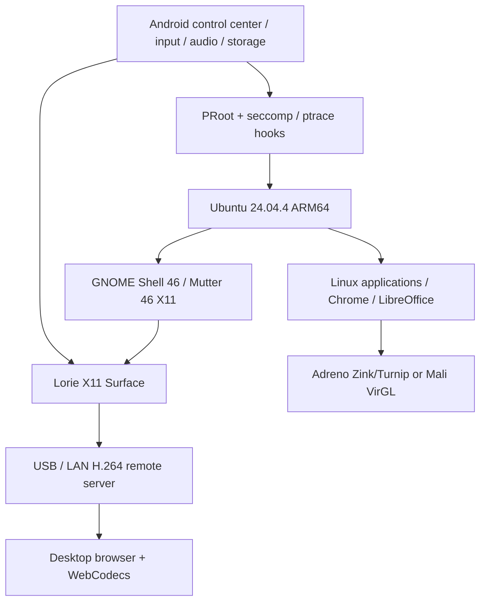

<h1 align="center">LinuxHub</h1>

  <strong>A complete Ubuntu GNOME workstation running locally on Android ARM64 devices.</strong>

  Ubuntu 24.04.4 · GNOME 46 · Lorie X11 · PRoot · Adreno / Mali · USB / LAN remote desktop

  <a href="README.md">简体中文</a> ·
  <b>English</b> ·
  <a href="ARCHITECTURE.md">Architecture</a> ·
  <a href="CHANGELOG.md">Changelog</a> ·
  <a href="CONTRIBUTING.md">Contributing</a> ·
  <a href="SECURITY.md">Security</a>

  
  
  
  
  
  
  

  No Root required · Runs locally · No remote virtual machine

  <a href="assets/screenshots/09-gnome-desktop.jpg">View the LinuxHub 2.0 GNOME desktop screenshot</a>

---

## LinuxHub 2.0 · Myth-Prometheus

> **LinuxHub runs a real Ubuntu GNOME desktop locally on Android ARM64 devices, with dual-vendor GPU acceleration, browser-based remote desktop, offline initialization, and a complete application environment.**

This release uses Ubuntu 24.04.4 ARM64, official GNOME Shell 46, Mutter 46 X11, Lorie X11, PRoot, and Mesa 27. Android provides display transport, input, audio, storage, and lifecycle management. Ubuntu provides the full Linux user space and desktop applications.

| Release | Runtime | Desktop |
|:---:|:---:|:---:|
| `Myth-Prometheus` | Ubuntu 24.04.4 + PRoot + Lorie X11 | Official GNOME Shell 46 / Mutter 46 |
| Android 9+ ARM64 | Dual-vendor application GPU | USB / LAN remote desktop |
| `com.linuxhub.myth` | Zink / Turnip / VirGL | H.264 + WebCodecs |

## Core capabilities

| Area | Capabilities |
| --- | --- |
| Linux environment | Ubuntu 24.04.4 ARM64, PRoot, APT, sudo, Chinese locale, offline integrity checks |
| GNOME desktop | Official GNOME Shell 46, Mutter 46 X11, Yaru, Ubuntu Dock, DING desktop icons |
| Applications | Nautilus, Settings, Terminal, Text Editor, LibreOffice, Chrome, Thunderbird, and more |
| GPU | Qualcomm Zink / Turnip, MediaTek VirGL / virpipe, automatic software fallback |
| Browser | Chrome uses the product GPU launcher; new-window and private-window actions are preserved |
| Terminal | Multi-session PTY, true color, Unicode, Chinese text, soft keyboard, editing keys |
| Remote desktop | USB / LAN browser access, HTTPS, pairing code, H.264, adaptive bitrate |
| Files and packages | Shared Android storage, XDG user directories, `.deb` installer, APT launcher refresh |
| Audio | PulseAudio → FIFO → Android `AudioTrack` speaker output |
| Mobile input | Touchpad, direct touch, pointer capture, external keyboard/mouse, clipboard, PiP |
| Reliability | First-frame detection, Surface keepalive, process watchdog, foreground services |

## Compatibility hooks and bridges

| Layer | Purpose |
| --- | --- |
| PRoot syscall hooks | `ptrace` / `seccomp` interception, path translation, fake root, UID/GID compatibility |
| `fake_id0` | Correct root-like file operations inside a user-space container |
| ashmem → memfd | Shader shared-memory compatibility between Android and Ubuntu |
| `getifaddrs` hook | `LD_PRELOAD` interception that exposes Android IPv4 / IPv6 interfaces to Ubuntu |
| Rust getifaddrs bridge | Private Unix socket and framed `TIF1` protocol between Android helper and glibc client |
| GNOME resource overlay | Aligns GNOME 46 startup, session mode, and first-frame visibility |
| DING compatibility | Desktop icons, file drag-and-drop, and clipboard integration |
| X11 Present / VBlank | Buffer submission, Damage tracking, GPU-copy completion, and artifact fixes |
| MediaCodec Surface | Xlorie renders directly into the Android hardware H.264 encoder input |
| Application wrapper | Every desktop application goes through `doro-gpu-run` for GPU selection and fallback |
| PulseAudio FIFO bridge | Ubuntu audio reaches Android through an isolated FIFO sink |
| JNI / Rust sessiond | Session control, environment validation, helper orchestration, and restart policy |

## Download, networking, and package installation

| Stage | Implementation |
| --- | --- |
| Browser | Chrome handles `http`, `https`, HTML, and common web formats |
| DNS / hosts | Repairs localhost, hostname, and container name resolution |
| HTTPS | Installs `openssl` and `ca-certificates` offline and rebuilds the trust store |
| Android storage | Binds `/storage/emulated/0` into the container; `/sdcard/Download` stays accessible |
| Linux downloads | Creates `~/Downloads`, GTK bookmarks, and localized XDG directories |
| APT | Pins the Ubuntu 24.04 `noble` repositories |
| `.deb` files | Opens through the LinuxHub package installer with ARM64 checks and APT installation |
| Post-install | APT `Post-Invoke` refreshes desktop entries, MIME associations, and GPU launch wrappers |
| App migration | Content-addressed markers update vendor apps after an APK overwrite upgrade |
| Terminal banner | `doro-fetch` renders a narrow-screen Ubuntu dashboard with a text fallback |

## Dual-vendor GPU

| Platform | Application renderer | Notes |
| --- | --- | --- |
| Qualcomm Adreno | Mesa Zink + Turnip | GNOME Shell stays on llvmpipe; applications use Adreno independently |
| MediaTek Mali | virpipe + VirGL | The Android-side VirGL server provides hardware rendering to Ubuntu |
| GPU failure | llvmpipe | Automatic fallback prevents black screens |
| GTK4 on Qualcomm | Cairo | Avoids corrupted tabs and damaged regions on affected Adreno Zink paths |

Mesa 27 fixes incorrect AArch64 CPU feature detection that caused SVE `SIGILL`, first-frame timeout, and failure to enter GNOME on affected Qualcomm devices.

## USB / LAN remote desktop

- USB access through ADB port forwarding and a browser
- LAN access through the phone's automatically detected HTTPS address
- Six-digit pairing code
- X11 rendered directly into a MediaCodec Surface and encoded as H.264
- Browser decoding through WebCodecs
- Keyboard, mouse, touch, and wheel input
- Latency-aware bitrate control, keyframe requests, stale-frame dropping, and optional input dropping

## Initialization and upgrades

- Guided permissions, GPU route, Linux username, and password setup
- Per-task progress, failure, timeout, and diagnostic messages
- Total timeout and no-output process watchdog
- APK overwrite upgrades preserve the rootfs, user directories, and configuration
- New APKs automatically reconcile GNOME, Mesa, and vendor applications
- Content markers avoid repeated full validation on every desktop start
- Symlink, hardlink, SUID/SGID, and merged `/usr` repairs
- At least 5 GB of free storage is recommended for the first initialization

## Android control center

- Live Ubuntu version, user, device, architecture, and GPU route
- Memory, storage, network, desktop resolution, and uptime
- Direct access to Terminal, GNOME Desktop, USB Remote, LAN Remote, and About
- Liquid-glass cards, local glass toolbars, and a transparent LinuxHub mark
- Foreground desktop notification with force-stop action
- Picture-in-picture, fullscreen, orientation, cutout, and keep-awake controls
- Android user activity refreshed every 120 seconds to prevent sleep during downloads or builds

## Architecture

## Quick start

1. Download the ARM64 APK from [Releases](https://github.com/xishanp/Linuxhub/releases).
2. Grant file access, notification, and battery optimization permissions.
3. Select the Qualcomm Adreno or MediaTek Mali GPU route.
4. Create the Ubuntu username and password.
5. Keep LinuxHub in the foreground while the offline initialization completes.
6. Open GNOME Desktop or Terminal from the home page.

## Compatibility

| Item | Requirement |
| --- | --- |
| Android | API 28 / Android 9 or newer |
| CPU | ARM64 |
| Root | Not required |
| Desktop | Official GNOME Shell 46 / Mutter 46 X11 |
| GPU | Adreno or Mali with automatic llvmpipe fallback |
| Remote desktop | USB or the same LAN |
| Browser | Chrome / Edge 109+ with WebCodecs support |
| Storage | App-private rootfs plus Android shared-storage bindings |

## Current boundaries

- Browser hardware video encoding is deferred to the next release.
- A production Chrome Wayland launch path is deferred to the next release.
- AAC / MP4 packaging is deferred to the next release.
- The Canvas 2D left-edge artifact under Wayland / Zink remains unresolved.

## License

LinuxHub is released under the [GNU General Public License v3.0](LICENSE).

Ubuntu, GNOME, Mutter, PRoot, Termux:X11, Lorie, Mesa, PulseAudio, and other components retain their original licenses and copyright notices. See [ACKNOWLEDGEMENTS.md](ACKNOWLEDGEMENTS.md).

---

  <strong>LinuxHub · Myth-Prometheus</strong> 
  A complete Ubuntu GNOME desktop on Android.

